## Data flows

### 1. Sign in and token lifetimes

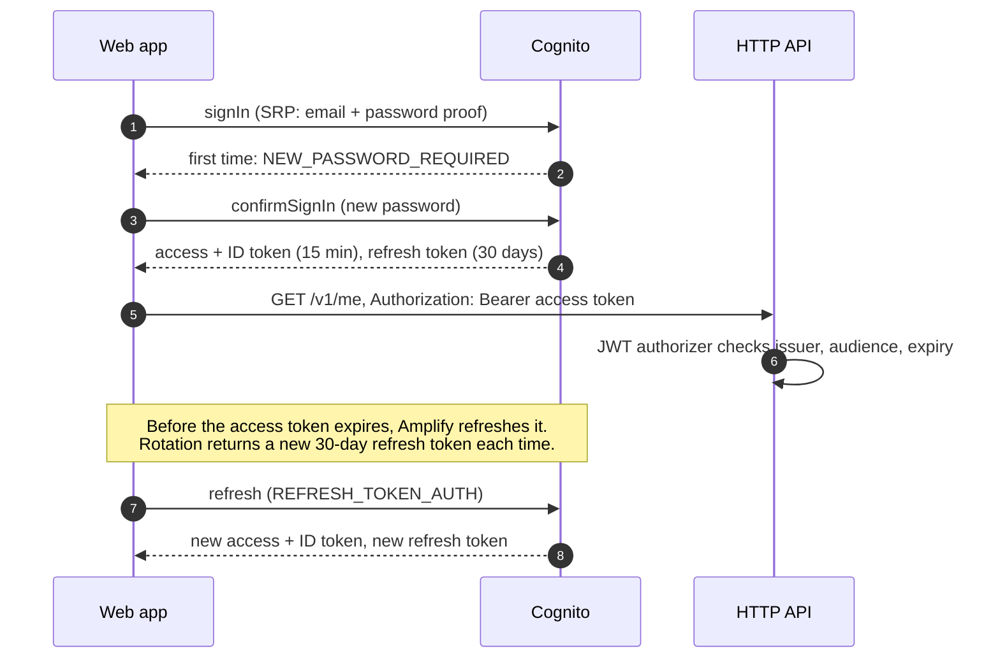

An owner who opens the app at least once every 30 days never signs in again. After 30 days without use the refresh
token expires and the sign-in screen appears. See [SECURITY.md](SECURITY.md).

### 2. Create a job and start `cf-prod-job-flow`

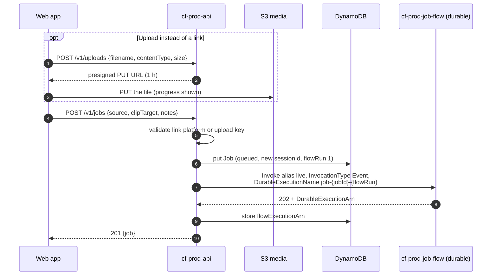

The start is idempotent: the payload has no timestamps, so starting the same name again either returns the running
execution or `DurableExecutionAlreadyStartedException`, which the API treats as "already started". **Retry** writes a
new `sessionId`, adds 1 to `flowRun` and starts `job-{jobId}-{flowRun}`. If the invoke itself fails, the job becomes
`failed` with "Could not start. Press Try again."

### 3. Job flow: the agent and its callback

`cf-prod-job-flow` replaces the watchdog. It costs nothing while it waits: the durable SDK checkpoints and the function
stops until the callback arrives.

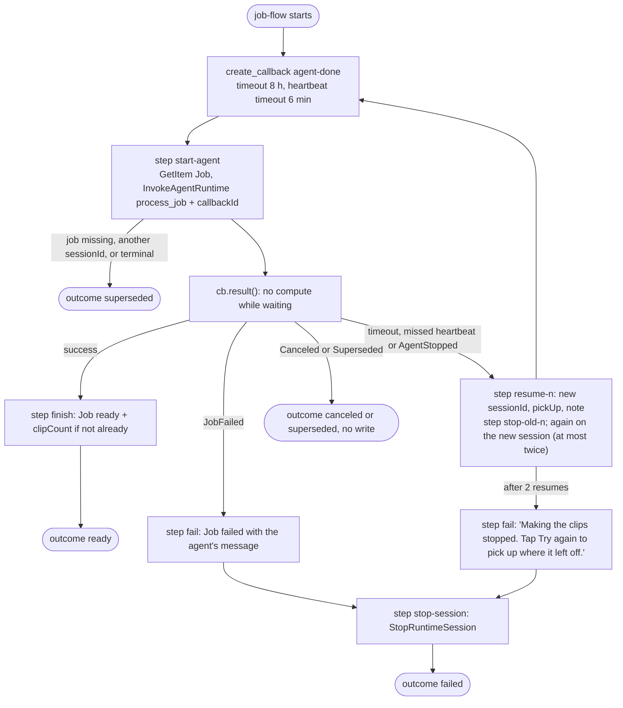

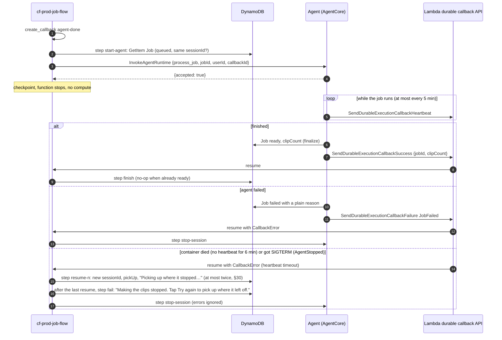

Every write by the flow is conditional on the Job's `sessionId`, so an old run can never overwrite a newer retry.
**Cancel** is handled by the API (Job `canceled`, `cancel` to the agent, `StopRuntimeSession`); the agent sends
`Canceled` and the flow writes nothing.

### 4. The agent pipeline

The agent owns the job record from the moment it accepts. Each step updates `steps[i]`, `progress` and `heartbeatAt`;
each write reaches the app through the live updates of flow 5. Details are in [AGENT.md](AGENT.md).

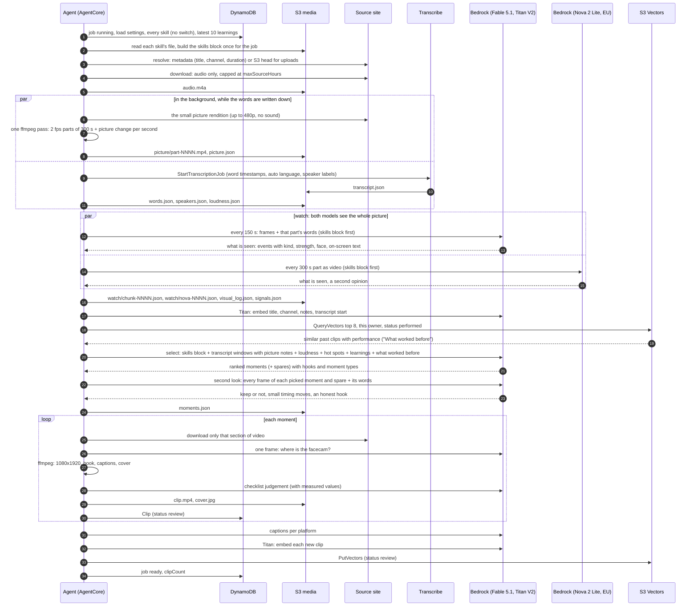

If the vector query fails, the agent logs `vectors.query_failed` and carries on without the section; fewer than three
`performed` hits are topped up with the owner's other clips.

**The picture is optional at every point.** The watch step never fails a job: when the small rendition cannot be
downloaded, ffmpeg fails, or a model is throttled, refuses or is not allowed, the agent logs it and picks from the
signals it has, down to exactly the words-and-loudness pipeline it was before
([AGENT.md](AGENT.md#watching-the-video), [ADR-40](DECISIONS.md#adr-40-watch-the-whole-video-before-picking)). The
fan-out (8 Fable chunks, 4 Nova parts at a time) is plain asyncio inside the one container, so cancel, the session
fence and the heartbeats work as for every other step.

### 5. Live updates over the WebSocket API

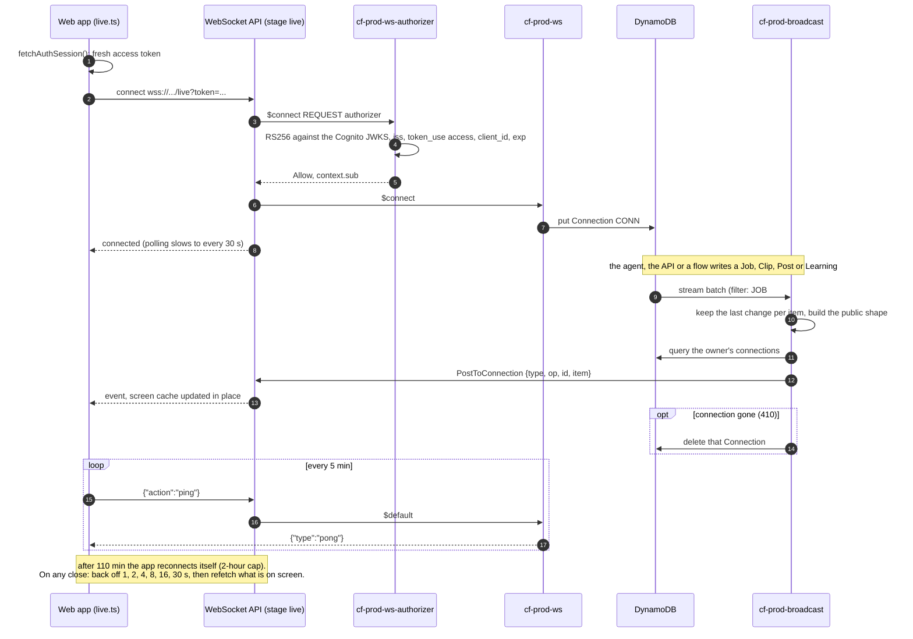

- Events carry the same public shapes as the HTTP API, so internal fields (`sessionId`, `videoKey`, `publishState`,
  `flowExecutionArn` and so on) never leave AWS. An event over 24 KB is sent as `partial: true` and the app refetches.
- The token is in the query string of the connect request, so the WebSocket access log has a fixed list of fields with
  no query and no headers, data tracing is off, and the Lambdas never log the token.
- Without a connection (mock mode, an old `config.json`, or a dropped socket) the app polls as before. Nothing on
  screen complains about a dropped socket.

### 6. Review, Keep and Throw away

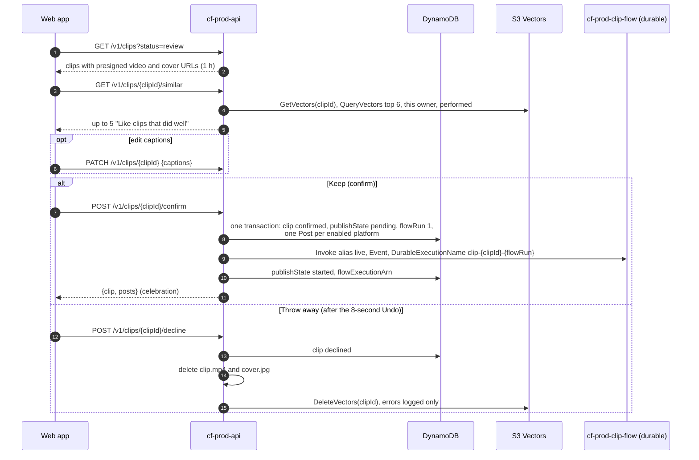

Keep is safe to press twice: a clip whose flow is `pending` is started again with the same name and payload (a no-op if
it is already running), and a `started` or `posted` clip just returns its current state. A clip that ended `failed`
shows **Try again**, which starts `clip-{clipId}-{flowRun + 1}`.

### 7. Clip flow: publish, wait 48 hours, learn

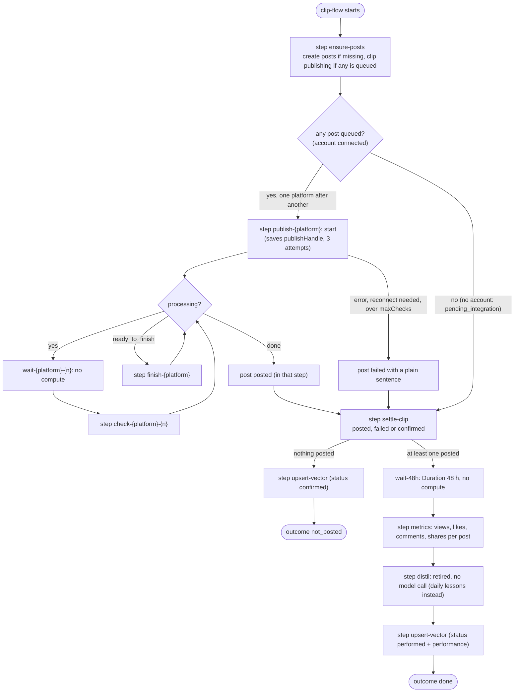

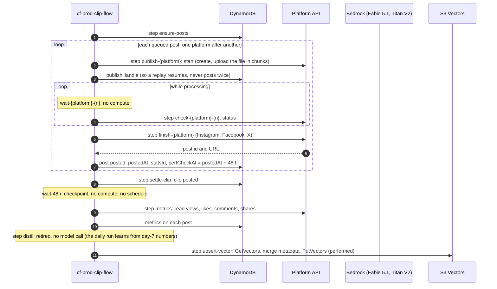

The `metrics` step reads the numbers through the same stats refresh as the poller ([flow 13](#13-clip-numbers-the-poller-and-refresh-numbers)),
so it shares the platforms' budgets. Every step is at-least-once, so each is written to be safe to repeat: posts are created only once (`postsCreated`),
a post is updated only while it is `queued`, and every platform call that creates something first saves a
`publishHandle`, so a replayed step resumes the upload instead of starting a second one. The few calls that cannot be
repeated safely on the platform side (TikTok init, Instagram `media_publish`, X post) are at-most-once: if one is
interrupted, the post fails with "We are not sure it posted. Look on {Platform} before you press Try again."
Publishing in detail is in [flow 16](#16-set-up-posting-connect-and-real-posting). A
durable execution stays pinned to the Lambda version it started on, so a deploy during the 48-hour wait never changes
a running flow.

### 8. The learning memory (S3 Vectors)

Each clip gets one vector (`key = clipId`) built from its moment type, hook, YouTube title and summary, embedded by
Titan Text Embeddings V2 (1024 numbers, normalised). Filterable metadata: `userId`, `momentType`, `platforms`,
`status` (`review`, `confirmed`, `performed`) and `scoreBucket`; stored but not filterable: `hook`, `title`, `summary`
and `performance`.

| When | Who | What happens to the vector |
|---|---|---|
| Job finishes | agent | created, status `review` |
| Before moment selection | agent | the top 8 `performed` clips of this owner like this source become "What worked before" in the prompt |
| Owner opens a clip | API | `/similar` returns up to 5 of the owner's measured clips most like it |
| Keep, nothing posted | clip-flow | status `confirmed` |
| 48 hours after posting | clip-flow | status `performed` with the summed numbers |
| Owner stars it as best of the week | `cf-prod-learn` | metadata `best = true` (unstarred: `best = false`); `best` clips come first in "What worked before" |
| Throw away | API | deleted |

Two kinds of memory work together: **learnings** are short sentences about what works in general; **vectors** find
specific past clips that resemble the one at hand, with their real numbers.

### 9. Platform webhooks (REST API)

Webhooks: nothing runs inline except storing the event. The OAuth callback on the same API is [flow 16](#16-set-up-posting-connect-and-real-posting).

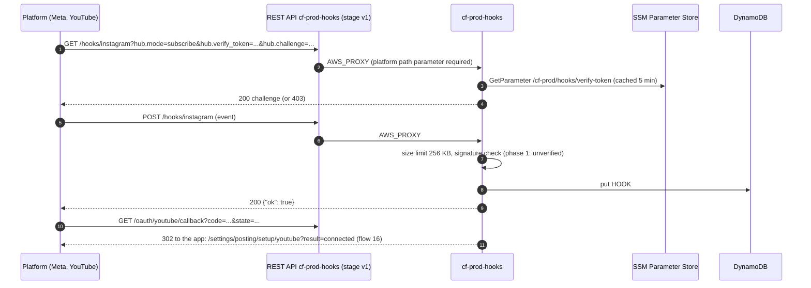

The REST access log has no query string (OAuth callbacks carry `code` and `state`). Each method is throttled to 10
requests a second (burst 20), and the `tiktok` and `x` webhooks answer `501` (not built yet); their OAuth callbacks work.

### 10. Deploy

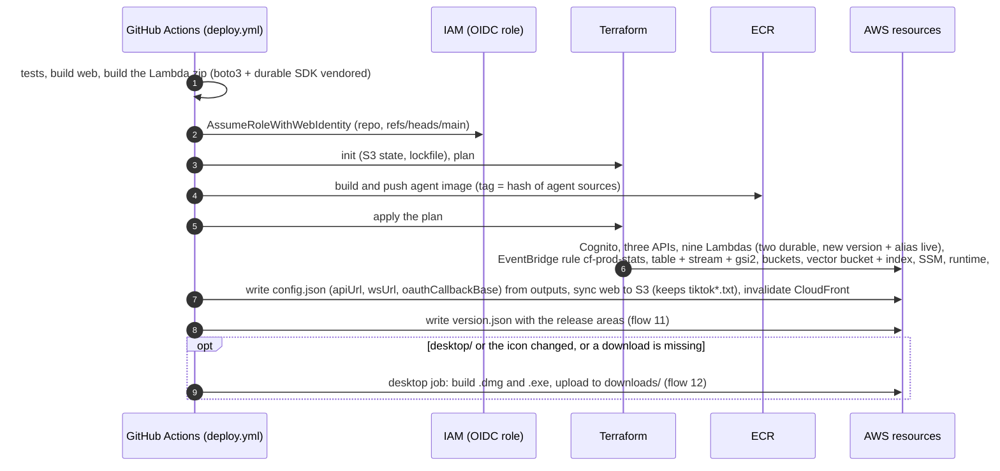

Step-by-step setup, including the one-time account settings, is in [DEPLOYMENT.md](DEPLOYMENT.md).

### 11. Updates: `version.json`, release areas and the update bar

Every deploy tells running apps that something is new, and in a word or three what it is
([CONTRACTS.md §12.2](CONTRACTS.md#122-update-banner-whats-new--reload)).

- **Build.** The web build embeds its own version (`VITE_APP_VERSION`, the short git sha).
- **Areas.** `scripts/release-areas.sh <prev-sha> <new-sha>` collects the labels. `prev-sha` is the `version` in the
  live `/version.json` in the web bucket. Rule, in order: the `Area:` lines in the commit messages between the two
  ([GIT_WORKFLOW.md](GIT_WORKFLOW.md#area-lines-what-the-update-bar-says)); otherwise the changed files mapped through
  `web/areas.json` (longest folder prefix wins, for example `web/src/routes/settings` → "Settings"); otherwise
  `["Improvements"]`. At most three labels, duplicates removed. With no live `version.json` (first deploy) the label
  is `["First release"]`.
- **Publish.** After the web files are synced, the deploy writes
  `{"version":"<short sha>","builtAt":"<ISO time>","areas":[...]}` to `/version.json` with `Cache-Control: no-store`.
  It is written **last**, so an app never sees a new version before its files are in place.
- **Detect.** The app fetches `/version.json` (bypassing every cache) on start, every 5 minutes, when the tab or window
  becomes visible, and when its service worker reports a waiting worker. A different `version` shows the update bar.
- **Reload.** The progress bar runs the [reload curve](UX_DESIGN_SYSTEM.md#the-reload-curve) while the app tells the
  waiting service worker to `skipWaiting`, waits for `controllerchange`, then reloads (at most 10 s).

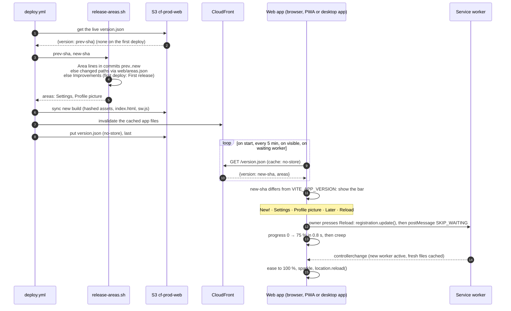

Installed apps (phone PWA, desktop PWA and the desktop app) run the same code, so they show the same bar. The desktop
app never needs its own update: it loads the site, and the site updates itself.

### 12. Get the app and the desktop wrapper

The app offers the right install for each device ([CONTRACTS.md §12.1](CONTRACTS.md#121-get-the-app-sidebar-item-on-phones-a-card-in-settings-plus-a-one-time-banner-on-home))
and the Mac and Windows downloads come from a thin Tauri v2 window ([§12.3](CONTRACTS.md#123-desktop-wrapper-desktop-tauri-v2),
[ADR-18](DECISIONS.md#adr-18-a-thin-tauri-desktop-wrapper-not-electron)).

**The wrapper** (`desktop/`) bundles no screens. It opens `app_url` in the system web view (WebKit on macOS, WebView2 on
Windows), sets the title "Clip Factory" and the app icon, keeps a 380 × 600 minimum size, remembers size and position,
opens outside links in the normal browser, appends `ClipFactoryDesktop` to the user agent and sets
`window.__CF_DESKTOP__ = true`, so the web app hides Get the app inside it. Sign-in, tokens, the service worker and the
live connection work as in a browser; tokens live in the wrapper's own web storage.

**The build** is the `desktop` job in `deploy.yml`. It runs after the web deploy, only when `desktop/**` or the app
icon changed or a download is missing from the bucket:

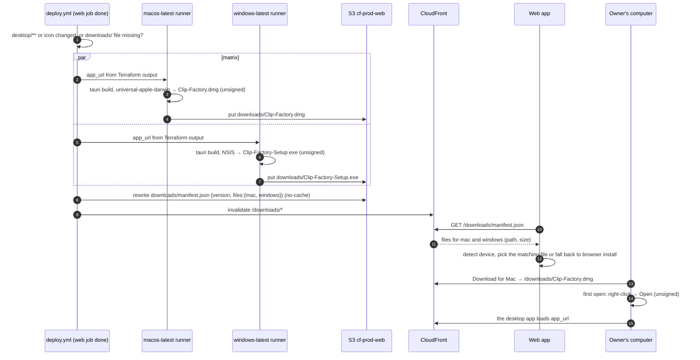

**Phones** never get a file. Android installs the PWA through the browser's own prompt. iPhone and iPad get three
picture steps to Add to Home Screen, because Apple allows no app download outside its store
([ADR-21](DECISIONS.md#adr-21-iphone-and-ipad-get-add-to-home-screen-steps-not-a-download)).

**Hiding it once installed.** The web app checks `display-mode: standalone` / `window-controls-overlay`,
`navigator.standalone` (iOS), the desktop wrapper markers, and `cf.installed=1` in local storage (set on the
`appinstalled` event).

### 13. Clip numbers: the poller and Refresh numbers

The owner sees every clip's numbers per platform on `/clips/{clipId}`
([CONTRACTS.md §16.5](CONTRACTS.md#165-poller-and-refresh-lambda-cf-prod-stats)). One code path,
`stats.refresh.refresh_posts`, reads them for three callers: the EventBridge tick (`reason "poll"`), the Refresh button
(`"manual"`) and the clip flow's `metrics` step after 48 hours (`"flow"`). All three go through the same per-platform
budget, so together they can never pass a platform's limit.

**What makes a post due.** When a post is published, its `statsDueAt` is set and it gets `gsi2pk = "STATS"`,
`gsi2sk = "{statsDueAt}#{postId}"`. That sparse index is the due-queue: only posts inside their 30-day window carry
it. After each reading the next `statsDueAt` is `readAt + interval`, where the interval depends on the platform and
the post's age ([ADR-29](DECISIONS.md#adr-29-stats-refresh-intervals-per-platform)):

| Post age | YouTube, TikTok, X | Instagram, Facebook |
|---|---|---|
| up to 48 hours | every 15 min | every 30 min |
| up to 7 days | every 30 min | every 60 min |
| up to 30 days | every 2 h | every 6 h |
| 30 days | one final reading, then the post leaves `gsi2` | same |

YouTube's slow insights (YouTube Analytics: watch time, engaged views, shares, new subscribers) are read at most every
6 hours (`insightsDueAt`), because Google needs 48–72 hours to process them. Private TikTok posts (unaudited app) have
no stats id and never enter the queue.

**The tick.**

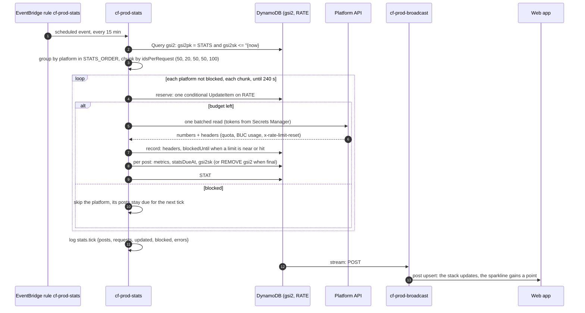

**Refresh numbers.**

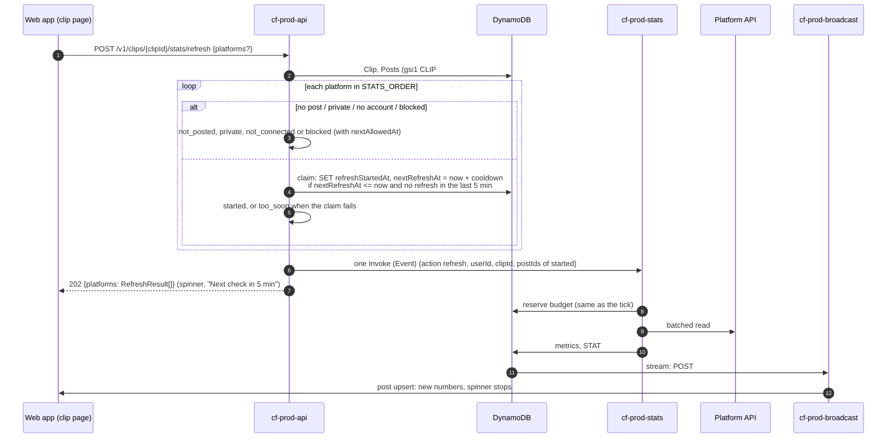

The cooldown is 5 minutes for YouTube, TikTok and X and 30 minutes for Instagram and Facebook, so pressing Refresh
again and again never spends more than the poller would. If the invoke itself fails, the API rolls the claims back and
answers `blocked` with "Could not check right now. Try again in a minute."

**Budgets** ([CONTRACTS.md §16.3](CONTRACTS.md#163-dynamodb-items)) are one item per platform (`RATE#{platform}`),
reserved with one conditional `UpdateItem` before every request, so two Lambdas at once can never both take the last
units:

| Platform | Counted as | Stop at | When a limit hits |
|---|---|---|---|
| YouTube | quota units per Pacific day (1 per `videos.list` call of up to 50 ids, 1 per Analytics report) | 7,000 of 10,000 (3,000 kept for uploads) | `quotaExceeded` / `rateLimitExceeded`: paused until 08:00 UTC |
| TikTok | requests per UTC minute | 300 of 600 | `429` / `rate_limit_exceeded`: paused 1 minute |
| Instagram, Facebook | Meta's `X-Business-Use-Case-Usage` header (call count, CPU time, total time, in %) | 75 % of any counter | throttle `80002` / `80001`: paused for Meta's `estimated_time_to_regain_access` (at least 60 min), **no retry** |
| X | requests per 15 minutes, plus an estimated spend | 1,000 of 3,500; $10 a month | `429`: paused until `x-rate-limit-reset`; monthly cap: paused until the 1st |

In phase 1 no account is connected, so every adapter answers `not_connected` and nothing reaches the network; the
poller, the queue and the budgets are already in place.

### 14. Best of the week

The owner stars the week's best clips in **Library › This week**; the picks teach the agent
([CONTRACTS.md §16.6](CONTRACTS.md#166-weekly-best-learning-lambda-cf-prod-learn),
[ADR-31](DECISIONS.md#adr-31-the-weekly-best-is-an-explicit-owner-signal), [AGENT.md](AGENT.md#best-of-the-week)).

A week is an ISO week (Monday start) in the **owner's own time zone**: the web computes `from` and `to` (local Monday
00:00 to the next Monday 00:00, as UTC instants, 167–169 hours across a clock change) and sends them with the week id.
A clip belongs to the week of its **anchor**: its earliest `postedAt`, or `decidedAt` while it is kept but not posted.

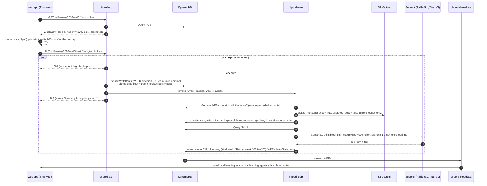

An empty set of picks deletes that week's learning and ends `skipped`. A model answer that is cut off, refused or
filtered ends `failed` ("Could not learn this time. Change a pick to try again."), and Bedrock errors are retried
twice. Because every write checks `revision`, a quick second save always wins over a slower first one.

### 15. Skills: every AI call gets every skill

The owner's rule: *"The whole AI system should use all of these skills by default, no matter what, as long as I add
them."* ([CONTRACTS.md §18](CONTRACTS.md#18-skills-full-create-read-update-delete-every-ai-call-uses-every-skill-owner-request-2026-11-16),
[ADR-32](DECISIONS.md#adr-32-every-ai-call-gets-every-skill-through-one-shared-skills-block)).

**Create, read, update, delete.** Skills live in Settings › Clip making › Skills. The owner writes one by answering
three questions (`POST /v1/skills`, the API builds the `SKILL.md`), uploads a `.md` or `.zip` (presigned PUT, then
`POST /v1/skills`), reads any skill (`GET /v1/skills`, `GET /v1/skills/{skillId}`), changes their own
(`PUT /v1/skills/{skillId}`, with a `version` check so two screens cannot overwrite each other silently) and deletes
their own (`DELETE /v1/skills/{skillId}`, sent when the 8-second Undo ends). Built-in skills ship with the code and can
only be read. There is no on/off switch: `PATCH /v1/skills/{skillId}` only answers "Skills are always used now".

Every save writes a **new object** `skills/{userId}/{skillId}/{revisionId}/SKILL.md` (or `skill.zip`) and then moves
the DynamoDB item's `key` to it, so an object never changes after it is written: a running job keeps reading the file
it started with, and readers can cache files by key.

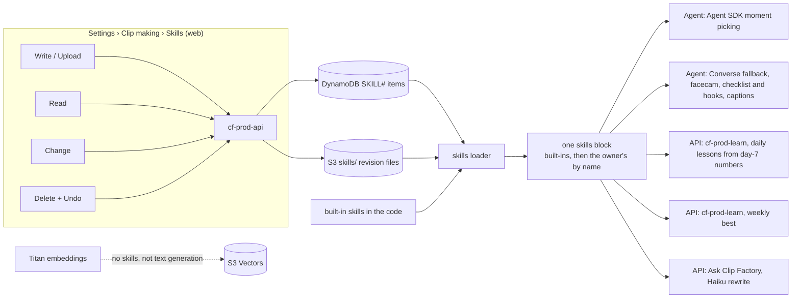

**One rule, two builders.** The agent (`agent/`) and the Lambdas (`api/`) each have the same small builder,
`skills_block(docs)`, checked against one shared reference file byte for byte. It puts every skill's `SKILL.md` text
inside `<owner_skills>`, built-ins first, then the owner's by name, at most 40,000 characters per skill and 120,000 in
total (built-ins are never the ones left out). `compose_system(block, task_system)` makes the block the **first**
part of every system prompt, followed by a Bedrock prompt-cache point when the block is 8,000 characters or more, so
the many calls of one job pay for the long, stable part once. If Bedrock refuses the cache point, it is turned off for
that process and the call is retried without it.

| Where | Model calls | How the skills are loaded |
|---|---|---|
| Agent (AgentCore Runtime) | Agent SDK moment picking; Converse: moment fallback, facecam, checklist (with the hook rewrite), captions | once per job at `analyze`; also written to `.claude/skills/` for the SDK |
| `cf-prod-learn` (weekly best, daily lessons) | `learn.converse_text` | `skill_prompt.load_skills` just before the call |
| `cf-prod-api`, Ask Clip Factory ([flow 17](#17-ask-clip-factory-the-help-assistant)) | `learn.converse_text` (Haiku 5.5, JSON schema) | `skill_prompt.load_block` per answer that reaches the model |

The Lambda loader reads the owner's `SKILL#` items with one Query and each file through a small in-memory cache keyed
by the S3 key (at most 64 files and 16 MB per container), so a warm Lambda reads S3 only after a skill changes. Both
`cf-prod-clip-flow` and `cf-prod-learn` may only `GetObject` under `skills/*` (no list); `cf-prod-learn` gets
`MEDIA_BUCKET`. A skill file that cannot be read is retried, then skipped and logged (`skills.skipped`); a failure to
read the skill items fails the step, whose normal retry runs, so no call quietly goes without skills.

**No way around it.** Each package has a test that reads its own source code and fails if a Converse, Agent SDK or
streaming model call is made anywhere except through these helpers, or without the `skills` argument. The only model
calls without skills are the Titan embeddings in `vectors.py`.

### 16. Set up posting, Connect and real posting

The owner sets up each platform once in **Settings › Posting › Set up posting**
([CONTRACTS.md §17](CONTRACTS.md#17-posting-setup-a-setup-list-per-platform-real-connect-real-posting-owner-request-2026-11-16),
the steps in [SETUP_POSTING.md](SETUP_POSTING.md)): make a developer app on the platform's website by following the
step cards, paste its keys, press **Check it**, then **Connect**. Numbered **10** in the diagram.

```mermaid
sequenceDiagram
  autonumber
  participant O as Owner (web app)
  participant A as cf-prod-api
  participant SM as Secrets Manager
  participant D as DynamoDB
  participant P as Platform (consent page, token endpoint)
  participant H as cf-prod-hooks (REST GET /oauth/{platform}/callback)
  O->>A: GET /v1/setup (steps done, gates, values to copy: redirect URI, privacy URL, ...)
  O->>A: PUT /v1/setup/{platform}/keys {clientId, clientSecret, configId?}
  A->>SM: create or put cf-prod/platforms/{platform}/app
  A->>D: SETUP#{platform}: keysSavedAt, masked hints only
  O->>A: POST /v1/setup/{platform}/check
  A->>P: key test (dummy code or client credentials)
  O->>A: POST /v1/accounts/{platform}/connect
  A->>SM: GetSecretValue cf-prod/oauth/state-key (cached 5 min)
  A->>D: OAUTH#{nonce} (TTL exp + 5 min)
  A-->>O: authorizeUrl (state = v1.nonce.exp.HMAC; PKCE challenge for YouTube and X)
  O->>P: same tab: sign in, approve
  P->>H: 302 ?code&state
  H->>H: verify HMAC, expiry, platform
  H->>D: consume OAUTH#{nonce} once (conditional delete)
  H->>SM: read app keys
  H->>P: exchange code (exact redirect URI, PKCE verifier), read profile
  H->>SM: write cf-prod/platforms/{platform}/token (or pending choices for Meta)
  H->>D: ACCOUNT#{platform} connected (name, avatar), SETUP#{platform}
  H-->>O: 302 {app_url}/settings/posting/setup/{platform}?result=connected
  D-->>O: live event "setup" (stream → cf-prod-broadcast → WebSocket)
```

**Values the owner copies.** `GET /v1/setup` serves every value a platform asks for, built from `APP_URL` and
`HOOKS_URL`: the website (`/about.html`), privacy and terms (`/legal/…`, on the app's own domain because TikTok
verifies by URL prefix and Google lists every domain, [ADR-37](DECISIONS.md#adr-37-about-privacy-and-terms-on-the-apps-own-domain)),
the data-deletion URL and one exact redirect URI per platform. TikTok's verification file is uploaded through the API
into the web bucket root and invalidated in CloudFront.

**The callback** is the only public step. It trusts nothing in the request except a state that it signed, that has not
expired and that has not been used; it always redirects to one fixed page with a code from a fixed list, never logs
the query, and stores tokens only in Secrets Manager ([ADR-34](DECISIONS.md#adr-34-oauth-with-a-signed-single-use-state-tokens-only-in-secrets-manager),
[SECURITY.md](SECURITY.md#platform-keys-and-tokens)). Meta can return several Pages or Instagram accounts: the choices
wait in a short-lived `pending` secret and the owner picks one in the app (`POST /v1/accounts/{platform}/choose`).
Instagram uses Facebook Login for Business with a **user** access token: the callback exchanges it for the
long-lived one (`fb_exchange_token`), reads `me/accounts` with each Page's `instagram_business_account`, and keeps
only the Pages that have one. One → connected at once; several → `choose`; none → `no_accounts`. The token secret then
holds the Instagram account id, the Page id and that Page's access token, which posting and numbers use.

**Gates.** What each platform still has to allow is a gate on the setup: YouTube `published_app` (the Google app must
be **In production**, or tokens die after 7 days), TikTok `app_review` and `posting_audit` (until both pass, posts are
"Only me"), Instagram and Facebook `app_live` (Reels stay visible to the owner until each Meta app is Live), X
`credits`. A platform is
**ready** when it is connected and no gate needs the owner.

**Posting.** The clip flow ([flow 7](#7-clip-flow-publish-wait-48-hours-learn)) asks `SecretsTokenProvider` for the
token (refreshed 5 minutes before expiry; TikTok and X rotate refresh tokens, so a 30-second lease serialises
refreshes and the new secret is written before use), then runs the platform's publisher
([ADR-35](DECISIONS.md#adr-35-every-upload-is-sent-as-a-file-and-posting-waits-inside-the-clip-flow)). Every upload is
sent as a file read from S3 in 8 MB ranges:

| Platform | Start | Check (durable wait between) | Finish |
|---|---|---|---|
| YouTube | resumable session on `www.googleapis.com/upload/youtube/v3/videos`, 8 MB chunks, privacy from Settings | `videos.list` processing status, every 30 s, up to 60 | – |
| TikTok | `creator_info`, then Direct Post `init` with the Post to TikTok sheet's choices, `FILE_UPLOAD` chunks | `status/fetch`, every 15 s, up to 80; the public id may come later (follow-up loop) | – |
| Instagram | publishing limit check, `REELS` container, upload to `rupload.facebook.com/ig-api-upload` | container `status_code`, every 60 s, up to 15 | `media_publish`, permalink |
| Facebook | `video_reels` start, upload to `rupload.facebook.com/video-upload` | video `status`, every 30 s, up to 40 | `video_reels` finish `PUBLISHED` |
| X | `media/upload` initialize, 4 MB appends, finalize | media status after `check_after_secs`, up to 20 | `POST /2/tweets` with links removed |

Disconnect (after an 8-second Undo in the app) revokes the token where possible, deletes the token secret and, for
YouTube, asks `cf-prod-stats` to `forget` stored YouTube numbers.

### 17. Ask Clip Factory: the help assistant

The owner asks "how do I…" or "where is…" and gets short steps plus a button that opens the page and lights up the
control ([CONTRACTS.md §19](CONTRACTS.md#19-ask-clip-factory-grounded-in-app-help-assistant-owner-request-2026-11-16),
[HELP_ASSISTANT.md](HELP_ASSISTANT.md), [ADR-38](DECISIONS.md#adr-38-bm25-over-vectors-for-help-and-the-model-is-optional),
[ADR-39](DECISIONS.md#adr-39-help-runs-in-cf-prod-api-with-claude-haiku-55-through-the-eu-profile)).

**Build time.** `web/scripts/help-corpus.mjs` turns the router, the navigation, the Settings tree, the screens and the
curated guides (`helpKb.json`) into `help-corpus.json` (committed). The Vite build also emits a content-hashed copy,
`/assets/help-corpus.<hash>.json` (cached forever), and names it in a `cf-help-corpus` meta tag in `index.html` (never
cached), so the API always finds the corpus that matches the deployed screens. `build_lambda.py` bundles the same file
into the Lambda zip as the fallback.

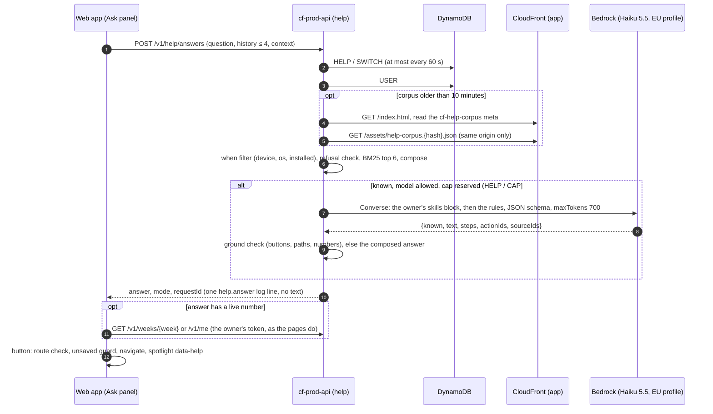

- **Without the model** the composed answer is complete; the model only rewords it. Unknown and refused questions
  never reach Bedrock. Any model problem (timeout, bad JSON, a stop reason, an invented button or number) returns the
  composed answer with `mode: "kb"`.
- **Skills**: like every model call ([flow 15](#15-skills-every-ai-call-gets-every-skill)), the help call goes through
  `learn.converse_text`, so the owner's skills block (`skill_prompt.load_block`) comes first and the help rules after
  it; the rules keep facts to the knowledge, the skills set the tone and the clip advice. If the skills cannot be read,
  the model is not called and the composed answer is used (outcome `kb_skills`).
- **In the browser**: help calls use their own quiet `fetch` (27 s timeout), so no page refetches. On a network
  error, a timeout or a 5xx the panel answers from its own copy of the corpus with the same rules; on 429 it shows a
  countdown and never retries by itself; on `help_off` the launcher disappears and the local copy is not used.

### 18. Ask as a full assistant (CONTRACTS §28, ADR-51)

```
browser ── whoami ──▶ cf-prod-ws ──▶ {connectionId}
browser ── POST /v1/help/files ──▶ cf-prod-api ──▶ presigned PUTs ──▶ cf-prod-media ask/{sub}/{fileId}
browser ── POST /v1/help/asks ──▶ cf-prod-api ── async Invoke ──▶ cf-prod-ask
cf-prod-ask ── skills, knowledge pack, APP STATE (DynamoDB reads) ──▶ Claude Opus 5.5 (Bedrock Mantle, eu-north-1)
            ◀── tool calls: web_search (Brave) · web_fetch (SSRF-guarded) · read_app_doc · read_my_clip_factory · show_app_buttons
cf-prod-ask ── PostToConnection ask.* ──▶ the owner's socket ──▶ the panel streams the answer
cf-prod-ask ── finally: delete ask/{sub}/{fileId}
```

The HTTP API keeps its 29 s limit: the answer runs in `cf-prod-ask` (150 s, async, never retried) and comes back as
events on the WebSocket the app already holds. The search key is the owner's own, in Secrets Manager
(`cf-prod/ask/search-key`). Everything Ask knows about the app is a generated pack shipped in the zip
(`api/src/clipfactory_api/ask/knowledge.json`, `ask/library/`), behind the owner's skills and cached for an hour.
When the socket, the model or the assistant switch is not there, the panel answers with §17 (above) instead.

### 19. Content Rewards campaigns (CONTRACTS §38, ADR-62)

The owner joins a paid clipping campaign on Content Rewards (CR), pastes its link into Clip Factory, and every clip
made for it follows its rules and is sent to CR inside CR's 30-minute window
([CONTRACTS.md §38](CONTRACTS.md#38-content-rewards-campaigns-owner-request-2026-11-21),
[ADR-62](DECISIONS.md#adr-62-content-rewards-the-official-sign-in-through-the-desktop-apps-loopback-door-sending-from-the-cloud-a-reminder-when-it-cant),
the owner's steps in [SETUP_POSTING.md](SETUP_POSTING.md#content-rewards)). Numbered **13** in the diagram.

CR is **not** a sixth `Platform`: it is its own connection (`CRCONN`), its own card on Set up posting, its own routes
under `/v1/contentrewards` and its own items. The five platforms, `GET /v1/setup`, the setup to-do list and the
publish chain behave exactly as before when no campaign is involved. The feature is **on** in prod
(`content_rewards_enabled = true` → `CONTENT_REWARDS=on`). It shipped switched off while its parts were built
(`false` → `CONTENT_REWARDS=off`: every `/v1/contentrewards*` route answers 503 `unavailable` and the clip flow sends
nothing); once every part of §38.19 had merged, the one-line switch PR #88 (21 Nov 2026) turned it on. Setting the
default back to `false` turns it off the same way ([DEPLOYMENT.md](DEPLOYMENT.md#content-rewards-contracts-38)).

**Who talks to Content Rewards.** Only `cf-prod-api`, `cf-prod-clip-flow` and `cf-prod-stats`, server to server.
Never the browser (CR answers 403 to any MCP request that carries an `Origin` header, and the token lives only in
Secrets Manager), never the Mac (it only carries a one-time code) and never `cf-prod-campaigns` (it reads untrusted
brand text and outside links, and has no secret access).

| Host | Used for | By |
|---|---|---|
| `id.contentrewards.com` | OAuth: `/oauth2/register` (RFC 7591, once per install, `client_name` "Clip Factory", five loopback redirects, no secret), `/oauth2/authorize` (in the owner's system browser), `/oauth2/token`, `/oauth2/revoke` | `cf-prod-api` (register, code exchange, revoke); the three Lambdas (refresh, under the lease) |
| `mcp.contentrewards.com/mcp` | MCP JSON-RPC: `get_me`, `list_my_campaigns`, `create_my_submission`, `list_my_submissions`, `get_my_submission`, `get_my_balance`, `list_my_payouts`, `send_feedback`; headers `Api-Version: 2026-10-01`, `MCP-Protocol-Version: 2025-11-25`, `Mcp-Name`, never `Origin`; at most 2 calls a second per container | `cf-prod-api`, `cf-prod-clip-flow`, `cf-prod-stats` |
| `contentrewards.com/api/campaign/campaigns/{uuid}` | the public campaign JSON (undocumented): a preview for the card, read only when the owner acts (add, Check now, a card older than 10 minutes, a job's start), at most 6 a minute, cached on the item, never on a schedule and never to submit | `cf-prod-api` |
| `crusercontent.com`, `docs.google.com`, Google Drive, Dropbox | the brand's picture (copied once, only `https://crusercontent.com/…`, ≤ 1 MB), the Google Docs a brief links to, logo links; the Google Docs and logo links go through the `ask/fetch.py` SSRF guard on every hop | `cf-prod-campaigns` |

**Sign-in: the desktop app's one-shot door.** CR's sign-in only returns to `http://127.0.0.1` (no https), so the
Mac app listens once on the computer, and the cloud keeps everything else.

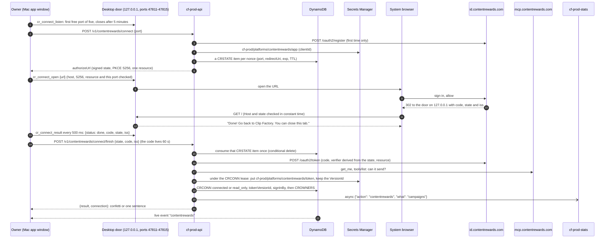

The door is macOS only (on Windows `listen` answers `unsupported` and the page shows the "browser on a computer"
words); it binds `127.0.0.1` only, answers one good request, never sees a token and never logs or stores the code.
The PKCE verifier is derived from the signed state, never stored. A phone or a plain browser gets "Do this step on
your Mac"; after this one sign-in everything runs in the cloud, so a phone upload is sent too.

**Tokens.** CR's access token lives 10 minutes; its refresh token is single use and rotates (a reuse more than a few
seconds later ends the connection), dies after 30 days unused and lasts 90 days at most. So exactly one process ever
refreshes: the `CRCONN` lease (as in §17.6), taken only with at least 20 s of Lambda time left; the secret is always
read by the `VersionId` recorded on `CRCONN`, never a cached or "current" copy; a lost answer is retried at once with
the same refresh token; the new secret is written put-only (a refresh can never re-create a disconnected secret)
before the token is used. Connect and Disconnect take the same lease. The stats tick refreshes once a day to keep
the sign-in alive, warns 7 days before `signInBy` (card and notification) and marks `needs_reconnect` after it.

**Adding a campaign.** `POST /v1/contentrewards/campaigns {url}` parses the link (campaign, Discover, the Whop copy, a
group; invite, checkout and other CR pages are refused with a sentence), reads the public preview, writes
`CAMPAIGN#{uuid}` and starts the rules read. Membership comes from `list_my_campaigns` (pending applications are not
listed): the page's UUID is matched to CR's `cmp_` id by its TypeID encoding, else by name, organization, access and
rates; two same-name siblings are `ambiguous` and never sent automatically. Joining stays in the CR app (there is no
tool to browse, join or apply). Pure code (`contentrewards/gates.py`, ported from the local app's `ruleCheck.js`)
makes the stops, the one next step and the `uploadPlaces` every time a campaign is served.

**Reading the rules** (`cf-prod-campaigns` `read`, async). The api and the stats tick store CR's listed
`description` on the item as `brief` before they start a read, so the reader needs nothing from CR. One Bedrock
Converse call with the clip agent's model and the local app's `RULES_SCHEMA` (ported) as a forced tool; the brief,
the owner's pasted rules and up to 3 public Google Docs the brief links to go in as JSON-encoded untrusted blocks
(`<` and `>` escaped). Code then checks every field: anything that can reach a caption, the screen or a link must
appear word for word in the input; fixed disclosure words (`#Ad`, "Paid partnership"); at most 8 hashtags and 5 tags;
CR's own toggles (drafts first, a sound, the logo) can only add stops; pay, budget, status, access and platforms
come only from CR's own fields. A read that fails or runs past 3 minutes is `rules_failed` ("I couldn't read the
rules. Tap Check now, or paste them below.").

**A campaign job.** `POST /v1/jobs {campaignId, campaignAnyway}` checks the campaign again (`list_my_campaigns` and
the public JSON, at most 8 s together; CR down → the stored rules and status), copies the rules onto the job
(`Job.campaign`, internal `JobCampaign`) and the ready logo to `jobs/{jobId}/source/campaign-logo.{ext}`, so a later
change never breaks a queued job. The agent follows `job.campaign` ([AGENT.md](AGENT.md#campaign-clips)): the length,
banned content, the logo in a taller band above the picture, "Paid partnership" on screen for the first 3 seconds,
"#Ad" first and every required tag in each caption. Without a campaign every prompt and file is byte for byte as
before.

**Posting a campaign clip.** Confirm (and Try again) accept only the campaign's `uploadPlaces` (paid for, ready in
Clip Factory, not refused by CR as unlinked, TikTok only after its audit), public, never made for kids, TikTok with
Branded content (the owner's own tap). Each post gets `campaignId` (fixed forever) and the internal
`postOptions.campaign`. The publishers turn on paid partnership where the API has it (YouTube
`paidProductPlacementDetails`, X `paid_partnership`, TikTok `brand_content_toggle`; Meta has no field for this kind
of app, so the caption's `#Ad` and the words on the video carry it), and `campaign_caption` puts the disclosure and
every required item back into a caption the owner edited. No publisher has a delete or unpublish call.

**Sending** (new steps in `cf-prod-clip-flow`, [CONTRACTS.md §38.12](CONTRACTS.md#3812-submitting-a-new-step-chain-in-cf-prod-clip-flow-and-checking-folded-into-cf-prod-stats)).
CR takes a post only while it is less than 30 minutes live, so the cloud sends it the moment it is live and public:

```
ensure-posts → publish-{platform} … finish-{platform} → cr-send-{platform}      (a post with campaignId)
             → (each later post's chain) → cr-catchup-{platform}                  (while earlier ones still wait)
settle-clip  → [cr-wait-{n} (60 s, no compute) → cr-retry-{n}] n = 1…26           (while any still wait)
             → wait-48h → metrics → distil                                        (as before)
```

`submit.send` writes `CRSUB#{postId}` once (`sending`, with the `idempotency_key`, URL and CR campaign id frozen,
`deadline` = posted + 25 min, `sendBy` = posted + 30 min) and calls `create_my_submission`. Retryable answers
(the post not visible yet, CR busy, 5xx, a timeout that may still have gone through) are tried again with the same key
every minute until `deadline`; then the post goes `send_by_hand` (time is left until `sendBy`) or `missed`. A CR step
never fails the flow: any exception sets `send_by_hand` / `missed`, and `settle-clip`, the 48-hour metrics and the
vector step always run. A clip with no campaign post has exactly the old step names.

**When Clip Factory can't send** (not connected, the pilot has not granted the write scope, a campaign the owner said
he is in by hand, an error that isn't his, or the 25 minutes ran out): the owner gets a notification "Send this to
Content Rewards now (N min left)" that opens the clip with one "Copy and open" button. In the Mac app, which has no
Web Push, a green banner (`CrSendNow`) shows the same line on every page.

**Checking** (`contentrewards.poll.run_tick`, called by the `cf-prod-stats` tick after the platform poll, with at most
45 s; it never raises and one owner's failure never stops another). For each `CROWNERS` owner, in this order:
1. time only, no CR call: `send_by_hand` past `sendBy` → `missed`; a stuck `sending` → `send_by_hand`; proofs due →
   one notification each; the pilot reminder every 3 days (at most 5); a rules read older than 3 minutes → failed;
2. the daily keep-alive refresh and the 90-day warning;
3. membership (`list_my_campaigns` to the end): waiting campaigns every tick for 7 days, then every 6 hours to day
   30; joined ones every 6 hours. Newly in → "You're in!" (confetti once, a notification) and a rules read;
4. money: `get_my_balance`, then `list_my_payouts` paid rows newest first down to a watermark (the first read pages
   to the end across ticks and shows "Checking…" until done, with no celebration for old money), then the pending
   rows; `reversed` rows never count;
5. submissions due: `list_my_submissions` newest first, then `get_my_submission` for the rest; a post the owner sent
   by hand is found by its normalized link; status, flags, removal, views, the brand's note.
At most 25 CR calls per owner per tick. Check now on a campaign runs step 3 for it at once; the clip page's Check now
runs step 5 for that clip; money refresh invokes step 4 through `cf-prod-stats`.

**Live and notifications.** The broadcast filter gains `CAMPAIGN#`, `CRCONN`, `CRSUB#` and `CRMONEY`, each sent as one
`contentrewards` event (`partial: true`) after which the web refetches `GET /v1/contentrewards`; `CRSTATE#` and
`CROWNERS` never travel and internal attributes are stripped. `cf-prod-notify` takes `MODIFY` records of the same
four, under the owner's choice "Content Rewards news" (`notify.contentRewards`, on by default): you're in, send now
(high urgency, its TTL the seconds left), approved, not approved, proof, money, sign in again, the pilot reminder;
each once (`NOTIFIED#cr#{key}`).

**Money.** Only CR's own numbers (§25 extended): `get_my_balance` and `list_my_payouts`, in USD cents, formatted
only. "Paid" may stand only next to CR's paid payouts. A campaign's rate × views is a guess and is never shown or
added anywhere; CR money is never added into the MRR cards. Its paid payouts of the last 30 days are added in one
place only: the total of All your money ([flow 20](#20-content-rewards-the-fit-check-the-copy-and-all-your-money-contracts-39-adr-63)).

**Data** (additive only, [CONTRACTS.md §38.11](CONTRACTS.md#3811-data-additive-only-new-sort-keys-new-attributes-a-new-s3-prefix-new-runtime-secrets)):

| Item or place | Holds |
|---|---|
| `USER#{id}` / `CRCONN` | the connection: status, can send, linked accounts learned from CR's answers, ticked steps, the Finance answer, pilot reminders, the lease and the token's `VersionId` (internal) |
| `USER#{id}` / `CRSTATE#{nonce}` | one Connect in progress (TTL) |
| `USER#{id}` / `CAMPAIGN#{uuid}` | one campaign: CR's id and match, the public copy, the brief, pasted rules, the checked rules, membership, the logo state |
| `USER#{id}` / `CRSUB#{postId}` | one campaign post's send: the frozen key, URL and campaign, state, deadlines, CR's review, views, earned money, appeal and proof |
| `USER#{id}` / `CRMONEY` | balance, paid total and its watermark, pending, celebrations |
| `CROWNERS` / `USER#{id}` | the poller's list of owners |
| `JOB#`, `CLIP#`, `POST#`, `SETTINGS` | + `campaignId`, `campaignNote`, the internal `campaign` snapshot, `paidLabel`, `postOptions.campaign`, `notify.contentRewards` |
| media bucket `campaigns/{userId}/{uuid}/` | the logo (`logo-{rev}.{ext}`) and the brand's picture; the job's copy goes to `jobs/{jobId}/source/` |
| Secrets Manager `cf-prod/platforms/contentrewards/{app,token}` | the registration and the token, made at runtime, never in Terraform |

No table, index, Cognito pool, bucket or secret is replaced; removing a campaign or disconnecting deletes nothing on
CR or any platform.

### 20. Content Rewards: the fit check, the copy and all your money (CONTRACTS §39, ADR-63)

The owner's follow-up the same day: Connect in time order, a pleasant choice between campaign clips and normal clips,
all his money in one place, and knowing before an upload whether a clip can earn on a campaign
([CONTRACTS.md §39](CONTRACTS.md#39-content-rewards-the-two-ways-all-your-money-and-does-this-clip-fit-owner-request-2026-11-21),
[ADR-63](DECISIONS.md#adr-63-content-rewards-follow-ups-one-fit-check-in-the-api-a-new-copy-instead-of-turning-a-normal-clip-into-a-campaign-clip-one-30-day-total-that-includes-content-rewards)).
No new Lambda, table, index, bucket or secret: three routes under `/v1/contentrewards`, one under `/v1/money`, new
attributes and one api setting. It is part of **13** in the diagram.

**The two ways** live in the web. Home at `/` is frozen (no campaign field on the normal form, 5 taps to an upload,
held by click-count tests); the campaign way is Home at `/?campaign={uuid}`, reached only from a campaign (the
"Your campaigns" row chip, the card, a campaign video, the fit). The API helps with three public fields made in
`contentrewards/campaigns.py`: `CampaignSummary.nextStepKind` (the row chip says "Make campaign clips" when it is
`make_clips`), and `sourceRuleText` and `languageRuleText` (the rule lines under the link box). Every link to a setup
page carries the `?back=` of the page it came from (`gates.next_step`'s Connect button and the `not_connected` stop's
`fixHref` use `?back=/campaigns/{uuid}`); the web accepts only six exact same-origin shapes.

**The fit check** (`contentrewards/fit.py`). One pure function, computed every time it is asked from stored items only
(never Content Rewards, the public campaign JSON or the network), so it can never go stale and Confirm can trust it:

```mermaid
flowchart LR
  items[("stored items: CLIP#, JOB#, CAMPAIGN#, CRCONN, POST#, CRSUB#<br/>+ gates.stops and gates.upload_places")] --> fit["contentrewards/fit.py<br/>fit(clip, job, campaign, ...) → CampaignFit"]
  fit --> get["GET /v1/contentrewards/fit<br/>Review card, clip page (no-store)"]
  fit --> caps["POST /v1/contentrewards/fit/captions<br/>campaign_caption per platform"]
  fit --> gate["Confirm, Try again, Post now<br/>409 on a no, remake or todo item"]
  fit --> copy["POST /v1/contentrewards/campaigns/{id}/remake<br/>409 unless canRemake"]
  get --> web["web lib/crFit.ts<br/>re-checks tags, #Ad, the paid switch and the places while he types"]
```

A campaign clip (`clip.campaignId ?? job.campaignId`) is checked against its own campaign only; a normal clip against
every campaign he is in (`in` or `manual`), newest first, at most 10, and `ClipFit.suggestion` is the first one a copy
could fix with a `source` item that passed. Each rule is one item (`campaign`, `soft`, `deadline`, `length`,
`places`, `place_link`, `tags`, `ad`, `paid_switch`, `logo`, `on_screen`, `source`, `language`, `banned`, `spoken`,
`uncertain`, `brief_only`, `posted`, `one_campaign`, `send`) with a state (`ok`, `fix`, `remake`, `todo`, `no`,
`check`, `note`) and the server's own words. The verdict, in this order: any `no` → `doesnt_fit`; a wait item (a held,
paused or re-read campaign) → `wait`; a `remake`, `todo` or paid-switch `fix` → `fixable`; a `check` → `cant_tell`;
else `fits`. Tag and #Ad fixes never change it, since the publisher puts them back at upload. Only exact facts can say
no: a channel that doesn't match by name, an unknown language or a rule the reader couldn't pin down is "I couldn't
check", never a pass and never a block. The source and language checks read `job.source.channelKeys` and
`job.sourceLanguage`, which the agent writes; without them they say "I couldn't check". The web refetches the fit
(debounced 1 s) on a `contentrewards` event, a `clip` event of the clip or its copy, a `post` event of the clip and a
`setup` event; there is no new live type.

**The gate on posting.** For a clip with a campaign (and `CONTENT_REWARDS=on`), Confirm runs the fit with the merged
captions, the chosen places and the TikTok choices; any `no`, `remake` or `todo` item answers 409 `conflict` "This
clip can't earn on FaZe Clips: {its words}" (a wait item: "Not yet for FaZe Clips: {its words}"), and `_try_again`
(Try again and Post now) does the same. A clip without a campaign never calls the fit and posts byte for byte as
before. `release.release_waiting` (§33.6) no longer restarts a waiting campaign post when its account comes back: it
waits for Post now, which goes through the fit, so a campaign post never goes up days later after the campaign ended
or was held.

**The copy (remake).** A normal clip that could earn is never turned into a campaign clip in place (it has no logo and
no "Paid partnership" on the video); a new one-clip campaign job is made from the same moment:

```mermaid
sequenceDiagram
  autonumber
  participant O as Owner (Review)
  participant A as cf-prod-api
  participant DB as DynamoDB
  participant S3 as S3 cf-prod-media
  participant JF as cf-prod-job-flow
  participant AG as Agent
  O->>A: POST /v1/contentrewards/campaigns/{id}/remake {clipId, macFetch?, campaignAnyway?}
  A->>DB: fit.for_clip: canRemake, and every soft stop accepted
  A->>DB: reserve first: SET remakes.{campaignId} = {jobId, at} on the original CLIP# (conditional)
  A->>S3: HEAD the original's kept video (jobs/{jobId}/source/video.mp4, else the Mac upload)
  A->>DB: new JOB# like POST /v1/jobs (start_job): source, notes, one clip, campaignId, rules snapshot, logo copy, remakeOf, internal remake
  A-)JF: async invoke, alias live
  A-->>O: 202 {job} ("Making a FaZe Clips copy… It shows here in about 3 minutes.")
  JF->>AG: process_job: the one moment of job.remake, no analyze, watch or select
  AG->>DB: one CLIP# with campaignId and remakeOf {clipId, jobId}
  DB-->>O: live clip event: the copy shows right after its original on the same Review page
```

A second call answers 200 with the job already named, so a double tap makes one copy; a failed, canceled or deleted
job, or a declined copy, frees the reservation. A link job whose kept video is gone fetches the link again; a video file
answers 409 "This video is gone from Clip Factory. Make new clips for this campaign." The agent's side is in
[AGENT.md](AGENT.md#a-campaign-copy). The copy has its own switch, `CR_REMAKE` (Terraform `cr_remake_enabled`).
It shipped off and is **on** in prod since its switch PR #93 (21 Nov 2026). Turned off, the route answers 503 "Coming
soon." and `canRemake` is false, so no "could earn" line shows.

**All your money** (`GET /v1/money/everywhere`, `money/everywhere.py`, pure). One period for the whole card, the 30
days up to the Monthly card's `through` (today when no platform money is stored). It reads `MONEYSTATE#`,
`REVENUE#{platform}#` (YouTube, and Facebook once `moneyVerified`), the Accounts, `config/monetization.json` and, while
`CONTENT_REWARDS=on`, `CRCONN` and `CRMONEY`; it never calls a platform or Content Rewards. Platform rows sum their
reported days in the period; Content Rewards sums `CRMONEY.paidByDay` over the same days (CR's `usd` written `USD`,
cents to micros × 10,000: units, never a conversion). The total adds only reported rows, one per currency, biggest
first. TikTok, Instagram and X are `not_available` with the "Look in …" line made from the config's `paidWhere`.
`paidByDay` is filled by the money read of `cf-prod-stats` (§38.12 step 4) from the paid rows' `paid_at` day; for an
owner whose first read finished before §39, a one-time `dayScan` (at most 8 pages a tick, only rows at or older than
the watermark) fills it and never touches the paid total.

**Data** (additive only, [CONTRACTS.md §39.3](CONTRACTS.md#393-does-this-clip-fit-the-campaign-the-fit-check)):

| Item or place | New attributes |
|---|---|
| `JOB#{jobId}` | `remakeOf` (public), `remake` (internal), `sourceLanguage` (public, from Transcribe), `source.channelKeys` (public) |
| `CLIP#{clipId}` | `remakes` (public, campaign → {jobId, at}), `remakeOf` (public) |
| `CRMONEY` | `paidByDay`, `paidByDayDone`, `dayScan` (internal) |
| api env | `CR_REMAKE` from `cr_remake_enabled` (shipped `false`; default `true` since PR #93), an in-place change |

No sort key, index, table, bucket, secret or Lambda is added, and nothing that holds the owner's data is replaced.
