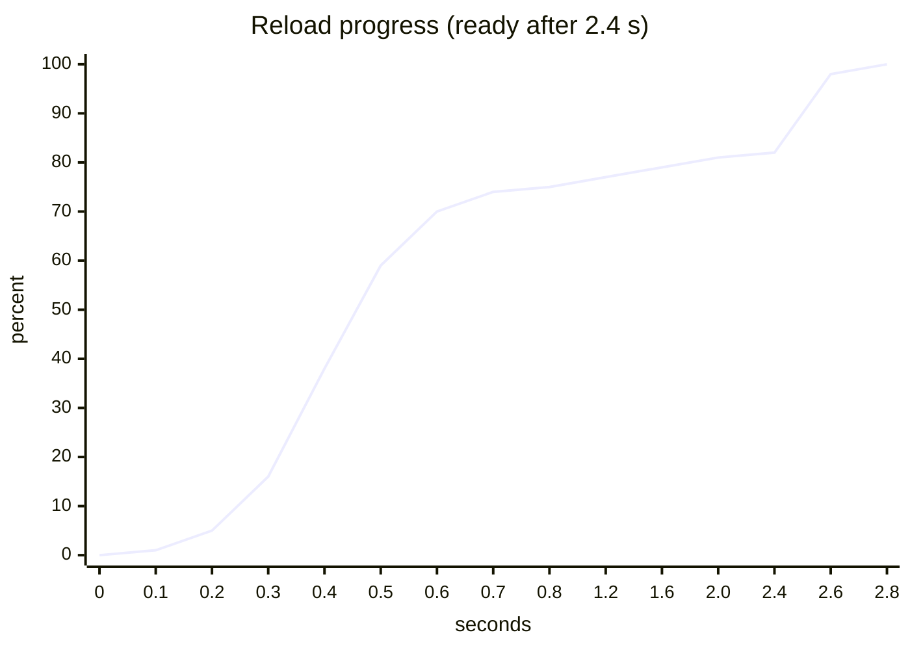

# UX design system

How Clip Factory Cloud looks, moves and sounds. The summary is in [CONTRACTS.md §11](CONTRACTS.md#11-design-system-summary-details-in-docsux_design_systemmd);
this file is the full reference. The code lives in `web/`; tokens are CSS custom properties on `:root`.

## Principles

1. **Every action is vermilion; one stands out.** Every call to action wears the same vermilion CTA, and each screen
   has at most one main one (`.btn--primary`). Everything else is quiet bone-outlined glass.
2. **Glass, never solid.** Every surface lets the backdrop show through.
3. **Nothing ever overflows.** Text wraps or truncates inside its box at every width from 320 px.
4. **Delight on the moments that matter.** Confirm, a finished job, a new skill. Not on every click.
5. **Plain English a child can follow.** Labels say what happens in everyday words: "Upload", "Throw away",
   "Make clips", never "Submit". See the [kid-proof checklist](#kid-proof-checklist).

## Colour tokens

The palette is the November 2026 bottle-green look ([DECISIONS.md ADR-43](DECISIONS.md#adr-43-bottle-green-glass-bone-words-vermilion-actions)):
**green is the surface, bone is the words, vermilion is the action.** Since ADR-45 the glass is see-through and draws
no edges anywhere (no borders, rings, rims or hairlines): a pane shows by its blur, tint and shadow, a control by its
fill. The tables below are the values
in `web/src/styles/tokens.css`. `web/test/designTokens.test.ts` fails if a row here and the CSS disagree, if a
colour or radius token in `tokens.css` is missing from these tables, or if this doc names a custom property the CSS
doesn't define. `web/test/background.test.ts` fails if a stylesheet writes words in a colour that is not one of the
six text colours (`--ink`, `--ink-2`, `--ink-3`, `--vermilion-ink`, `--green-ink`, `--green-text`) or a named
exception (white on a vermilion fill, `--on-bone` on a bone fill, Safari's blue in the Get the app drawings).

| Token | Value | Use |
|---|---|---|
| `--green` | `#0f372b` | Bottle green: every glass tint, veil and scrim; words on bone |
| `--green-deep` | `#0a2820` | Deeper green: code blocks, wells under words, sheet scrims, words on a leaf fill |
| `--green-2` | `#1b4a3b` | Raised green: cover and avatar placeholders (bone on it 8.19:1) |
| `--green-3` | `#2a5c4a` | Mesh highlight green: backdrop blobs, placeholders (bone on it 6.27:1) |
| `--green-leaf` | `#5fa585` | Success fills: done ticks, ring progress, the success tint, the toast timer |
| `--bone` | `#efe7da` | Bone: the words, the selected pill, the tooltip, the control fill's lift |
| `--bone-deep` | `#d9cdb8` | Pressed bone fills |
| `--vermilion` | `#e8392b` | Accent dots, progress fills, the Ask mark's dot, the Glide bar and dot, the swash, the best chart line |
| `--vermilion-deep` | `#c42a1e` | Badges and counts (white on it 5.68:1), the outer focus ring |
| `--vermilion-light` | `#f07a6c` | Progress gradient ends, glow tops, the error toast icon |
| `--ink` | `#efe7da` | Body text, headings, icons (bone) |
| `--ink-2` | `#efe7da` | Secondary text (bone: the hierarchy is size and weight) |
| `--ink-3` | `#efe7da` | Meta text (leaves, hints, timestamps, placeholders), bone too |
| `--vermilion-ink` | `#ffe2dc` | Error and warning **words**, always with a vermilion icon or dot. Vermilion itself is never used for words (3.15:1 on solid green) |
| `--green-ink` | `#e4f2da` | Success words and icons (saved, connected, passed) |
| `--green-text` | `#e4f2da` | Words on the success tint (the apple tag, the sound number tiles) |
| `--on-bone` | `#0f372b` | Words on a bone fill: the selected pill, inverted chips, the tooltip (10.68:1 on solid bone) |

`--green-rgb`, `--green-deep-rgb`, `--green-leaf-rgb`, `--bone-rgb` and `--vermilion-rgb` hold the same colours as
space-separated channels so CSS can add alpha: `rgb(var(--green-rgb) / 0.3)`. `--shadow-rgb` is the base of every
drop shadow and `--line-rgb` (bone) of the few marks that are not box edges (scrollbars, link underlines, ring
tracks). Shared fills: `--cta` (the CTA gradient), `--fill` and `--fill-hover` (deep green wells under words),
`--tint-leaf`, `--tint-vermilion` and `--tint-amber` (tints laid over deep green, so a chip is never lighter than its
panel), `--selected` (bone 0.92).

**One text set everywhere (ADR-45).** Every text colour is bone or lighter in every look (the window look used to have
its own lighter set; now all looks use it), so the panels need the least green; the hierarchy comes from size,
weight and spacing. A soft green halo (`text-shadow`) sits behind words on glass for comfort only: it is never
counted toward AA.

**No edges, and how things still read as controls.** Where an edge carried meaning, a fill or a soft glow does now:

| Token | Use |
|---|---|
| `--fill-control` | Buttons without a fill of their own (glass, ghost), drop zones, check chips, step numbers: a bone lift (0.08) over a step more green than a panel (`--panel-veil` + 0.10), the pick-one track's recipe |
| `--fill-field` | Text fields and the link box: deep green 0.45, a well deeper than the panel |
| `--shade-field` | The field's soft inner shade (blurred, never a line) |
| `--glow-bone`, `--glow-vermilion`, `--glow-leaf` | Soft glows (18 px blur) for a chosen, live, best or done thing, instead of a ring |

The only lines left are the allowed ones: the keyboard focus ring while `:focus-visible`, the temporary "found"
highlight from search and Ask's spotlight, progress bars and rings, the switch track, spinners, and text underlines.
`web/test/background.test.ts` fails on any other border, ring or hard line in a stylesheet, and
`web/e2e/edges.spec.ts` on any visible one on any screen.

Glass tints are not tokens: each glass variant sets its own `--glass-tint` gradient (in `web/src/styles/glass.css`),
and a component may override it. Every tint is bottle green; `--panel-veil` is how much.

| Class | `--glass-tint` |
|---|---|
| `.glass` | green at `--panel-veil` + 0.04 → green at `--panel-veil`, 140° |
| `.glass--green` | one step deeper: green + 0.10 → deep green + 0.08, 150° (the hero, the Ask launcher, the setup list's card) |
| `.glass--vermilion` | the panel, a breath of vermilion (0.16 → 0.08), then green 0.20 over it |
| `.glass--clear` | the panel tint |
| Nested `.glass` | transparent: the outer panel already gives the words their green |
| Floating layers | green `--float-veil` (0.73) + 0.02 → 0.73, blur 28 px (toasts, the Ask panel and sheet, the setup list, pill and sheet, the update bar): content scrolls under them, so they plan for white |
| The tab bar | green `--tabbar-veil` (0.59) + 0.03 → 0.59, blur 28 px (icons only, 3:1 over white) |
| The question sheet | green 0.88 → 0.86, over its own scrim |
| No `backdrop-filter` | green 0.92 → 0.90 |
| `prefers-reduced-transparency` | green 0.94 → 0.92, and the backdrop veil 0.94 |

Contrast: body text is `--ink` (bone) on green glass, 10.68:1 on solid green. The CTA's white label is at least
4.5:1 because the fill is vermilion a shade deeper (`--cta`, 4.96–6.03:1). Every vermilion dot on glass carries a
soft glow of its own or sits beside words that carry its meaning. Never put text directly on the moving backdrop:
loose words get a scrim at the panel tint.
`web/e2e/contrast.spec.ts` checks the rendered contrast and text size of every screen, in every look (see
[TESTING.md](TESTING.md)).

## The liquid glass recipe

```css
.glass {
  --glass-tint: linear-gradient(140deg, rgb(var(--green-rgb) / calc(var(--panel-veil) + 0.04)), rgb(var(--green-rgb) / var(--panel-veil)));
  position: relative;
  isolation: isolate;
  background: var(--glass-tint);
  -webkit-backdrop-filter: blur(var(--glass-blur)) saturate(var(--glass-saturate)); /* 18px, 1.6 */
  backdrop-filter: blur(var(--glass-blur)) saturate(var(--glass-saturate));
  border: 1px solid transparent; /* keeps the box size; no edge is drawn */
  border-radius: var(--r-lg);
  box-shadow: var(--shadow-1);
}
:where(.glass) .glass {
  --glass-tint: transparent; /* nested glass: the outer panel gives the green */
}
```

`--panel-veil` is 0.33 over the app's own living backdrop (worked out over every blob subset, both field ends, every
`saturate()` the CSS uses and the grain at its peak, `lib/background.ts`), 0.73 over a white desktop or photo, and between the two for
light owner colours.

Variants: `.glass--green` (hero, Ask launcher), `.glass--vermilion`, `.glass--clear`. In Chromium, `.glass--refract`
also bends the backdrop through the `#cf-refract` SVG filter.

**Buttons.** Every action is the vermilion CTA (`.btn--primary` for the screen's one main action, `.btn--action` for
the rest, the same look). Secondary buttons (`.btn--glass`, `.btn--ghost`: Skip, Not now, Back) wear the soft
control fill (`--fill-control`) with bone words and no ring; `.btn--danger` a vermilion tint over the same green with
`--vermilion-ink` words. Selected things in a pick-one bar (the `<Glide>` pill, the menu, the tab bar) are bone
with `--on-bone` words, with the vermilion bar or dot riding along on the bone.

**What is behind the glass (Settings › Look & feel › Background, [CONTRACTS.md §22](CONTRACTS.md#22-background-modes-and-see-through-glass-owner-request-2026-11-16)).**
Three choices, picked from three preview tiles with one sliding highlight:

* **See-through (the default).** In the Mac and Windows app the page itself is transparent and the window's own
  glass shows what is behind it, blurred by the system: macOS Liquid Glass (26+) or the under-window vibrancy
  material, Windows 11 acrylic, Windows 10 blur. You can guess the shapes (the edges of a car on the wallpaper), never
  read them. In a browser, an installed web app or on a phone nothing can look behind the page, so see-through shows
  the **frosted Clip Factory colours**: a deep green mesh with a vermilion glow and a faint bone highlight, behind a
  green frost, with two soft highlights slowly moving through it like light in glass. The Background page says why
  in one plain sentence and links to Get the app.
* **Picture.** The owner's own photo (kept on the device), under a bottle-green veil.
* **Colours.** 1 to 3 colours from the named swatches or the owner's own, drifting as a soft mesh.

**Glass strength** (see-through): Clear (default) shows more of what is behind, Frosted less. In a browser or on a
phone it thickens the frost over the Clip Factory colours, so it always does something.

**The tint keeps text readable on every background.** Its strength is worked out, not guessed (`lib/background.ts`):
the smallest bottle green at which every text colour that can sit on it reaches 4.5:1 on the **lightest** thing
behind. The words are light, so a white desktop or a white photo is the hardest case, not a dark one.

**In see-through the tint sits on the panels, not on the window.** Between panels the desktop shows through the
window's own glass untouched (Clear) or under a green frost (Frosted, 0.30). Every glass panel, and every piece of
text that sits straight on the window (page title and its line, breadcrumbs, headings and lines between panels),
carries the panel tint; loose text gets it as a plate of real padding behind the words (never a spread shadow, so
it never hugs or cuts a letter): the plate starts at the page edge like a panel and its words start where a panel's
words start (`--loose-x`). The picture look uses the same plates.

| Backdrop | Lightest thing behind | Tint |
|---|---|---|
| See-through, every native glass (Liquid Glass, vibrancy, acrylic, blur), either setting | White (Liquid Glass over white was measured at rgb(249, 248, 245)) | Panels: **Clear 0.73; Frosted 0.88** over the 0.30 window frost |
| Picture | A white photo | 0.35 over the photo, then panels at 0.65 (together 0.77) |
| Colours | The lightest colour (a blend of two is never lighter than both) | 0 (dark colours) up to 0.77 (white), over the whole backdrop; the default needs 0.74; the previews in Settings wear it too |
| See-through in a browser, or Picture with none on the device | The mesh's bone highlight | A green frost of 0.15 everywhere; panels 0.45 |
| Reduce transparency (system) | – | 0.94 everywhere, panels 0.92 |

**Rules that keep every word readable** (`styles/glass.css`; the numbers are checked in `web/test/background.test.ts`):

* **Floating surfaces keep their own denser tint** (toasts, sheets, the Ask panel, the update bar, a starred star).
* **Nothing that holds words is weaker than the panel tint**: the tab bar, glass, ghost and danger buttons and the
  Library tabs carry at least that much, wherever they sit.
* **Pick-one tracks** (segmented bars, tab rows, the Background tiles, the AI models) carry 0.10 more green than a
  panel, with a lift of bone (0.08) so the track still shows.
* **Fills under words are never lighter than their panel.** Wells are deep green (`--fill`); the success and
  vermilion tints lay deep green (0.35) under their colour (`--tint-leaf`, `--tint-vermilion`). Hover answers with
  more green (and a soft glow for a chosen thing), never with a lighter fill and never with a ring.

## Typography

Sizes are the tokens in `web/src/styles/tokens.css`; refer to them by name, never by a copied number.

| Role | Font | Size token | Weight / style |
|---|---|---|---|
| Display (Home hero) | `--font-display`: Times New Roman, Tinos, serif | `--fs-display` = `clamp(2.35rem, 1.55rem + 3.6vw, 4.5rem)` | 400, italic words, tight leading 0.98 |
| H1 (page titles, `.display-2`) | `--font-display` | `--fs-h1` = `clamp(1.95rem, 1.45rem + 2.1vw, 3.1rem)` | 400, often italic words |
| H2 (section titles, `.display-3`) | `--font-display` | `--fs-h2` = `clamp(1.45rem, 1.2rem + 1vw, 2.05rem)` | 400, italic words |
| H3 (subheads, e.g. skill text) | `--font-ui`: Inter | `--fs-h3` = `clamp(1.05rem, 1rem + 0.25vw, 1.2rem)` | 700 |
| Body | `--font-ui` | `--fs-body` = 1rem (16 px, never smaller on phones, so iOS does not zoom inputs) | 400, leading 1.5 |
| Small / meta | `--font-ui` | `--fs-small` = 0.875rem | 500–600 |
| Tiny labels (chips, star word) | `--font-ui` | `--fs-xs` = 0.78rem | 600–700 |
| Numbers (stats) | `--font-ui`, `font-variant-numeric: tabular-nums` | per component | 600–750 |

Nothing is set smaller than `--fs-xs`, badges and stickers included (the tab bar and sidebar counts, the sound
**Pick** sticker, the "Like clips that did well" meta line). `web/test/styleFloors.test.ts` fails on any smaller
`font-size`.

The vermilion **swash**: a hand-drawn SVG underline under one or two italic words of a display headline ("Make it
*viral*"). Used once per screen at most.

Both fonts are bundled with the app, never loaded from Google Fonts: `web/src/main.tsx` imports Inter Variable
(`@fontsource-variable/inter`) and Tinos 400 and 400 italic (`@fontsource/tinos`), so they are built into the app and
cached for offline use. Tinos is the metric-compatible twin of Times New Roman, used where Times New Roman is missing
(Android, Linux). The public pages (`about.html`, `legal/*.html`) load no webfonts on purpose; they use the same stacks
(see [CONTRACTS.md §17.3](CONTRACTS.md)).

Relative times use one style everywhere (`relative()` in `web/src/lib/format.ts`; the clip page's `ago()` uses it):
"just now", "3 min ago", "2 h ago", "yesterday", "4 days ago", and ahead "in 5 min", "tomorrow", "in 2 days". Durations
read "6 h 10 min". Neither ever says "60 min" or "24 h".

## Layout and spacing

- Spacing scale (px): 4, 8, 12, 16, 24, 32, 48, 64. Tokens `--space-1` … `--space-8`.
- Radii come from the scale below. Every `border-radius` uses a token (or `calc()` on one for the inner corner of a
  padded box); only hairline bars and tiny thumbs under 8 px, circles (`50%`) and `inherit` stay literal.
  `web/test/designTokens.test.ts` fails on any other hard-coded radius.

| Token | Value | Use |
|---|---|---|
| `--r-xs` | `10px` | Small chips, thumbs and inputs inside rows |
| `--r-sm` | `12px` | Inputs, buttons inside cards, small tiles |
| `--r-md` | `18px` | Cards, chat bubbles, list rows |
| `--r-lg` | `26px` | Panels and glass surfaces (the `.glass` default) |
| `--r-xl` | `34px` | Hero cards and the clip page's big panels |
| `--r-pill` | `999px` | Pills, chips and pill buttons |

- Content max width 1200 px, centred. Gutters 16 px on phones, 24 px on tablets, 32 px on desktop.
- **One text line down the left of a page.** Panels pad their sides by `--inset`; words that sit loose on the page
  (the page title and its line, breadcrumbs, back links, headings and lines between panels, the review count, a
  skill's meta line) start `--loose-x` in (the panel's 1 px rim plus `--inset`), so their first letter lines up with
  the first letter inside the panels below, in every look and at every width. Cards pad their sides by `--inset` too
  (branch cards, the Home hero, the Get the app banner, job rows, the views total, Library cards, Review cards), so
  their icon tile, thumbnail or first word sits on the same line; the breadcrumb's first word too (`e2e/text-line.spec.ts`
  checks it at 320, 390, 768 and 1440 px). Boxes (panels, buttons, pick-one tracks, the Back pill) keep the page edge.

| Token | Value | Use |
|---|---|---|
| `--inset` | `clamp(16px, 2.6vw, 24px)` | A panel's side padding: where words start inside it |
| `--loose-x` | `calc(var(--inset) + 1px)` | Where loose words start: a panel's rim plus `--inset` |
- Grid: one column on phones; cards in rows of 2 from 768 px, 3 from 1100 px (`repeat(auto-fill, minmax(min(100%, 300px), 1fr))`).
- Breakpoints: phone < 768 px, tablet 768–1099 px, desktop ≥ 1100 px.

**Layout inspiration** (the "Sorrel" reference): a big serif italic headline on a green hero card, pill buttons beside
it, a row of cards below, and a rating-style stat block (for example "8 clips waiting · 3 jobs running · 24 posted").
The person in the reference image is not used.

## Navigation

| Width | Navigation |
|---|---|
| < 768 px | Bottom glass tab bar, **icons only**, no words. Each icon has an `aria-label` and a tooltip on long-press. Five items: Home, New job, Review (with badge), Insights, Settings. Respects `env(safe-area-inset-bottom)`. Each target ≥ 48 × 48 px. "Get the app" is not a tab: it is the Settings › App & account › Get the app branch and a one-time banner on Home. |
| ≥ 768 px | Left glass sidebar with icons and names. A hamburger (three stripes) at the top collapses it to icons only; the choice is remembered on that device. Collapsed items show their name as a tooltip. A **Get the app** item (download icon) sits at the bottom of the sidebar, apart from the main items, and disappears once the app is installed. |

The active item uses a bone pill and a small vermilion dot. The current page has `aria-current="page"`.

## Settings tree

The owner's picture: "there is a field which is the entire settings, then we have apple trees which has multiple
trees, and each tree has multiple branches, and each branch has multiple apples, but they also have leaves ... so that
it is all organized." Settings is built exactly like that, and every setting has one place in it. The contract is
[CONTRACTS.md §15](CONTRACTS.md#15-settings-as-a-tree-and-choosing-your-click-sounds-owner-request-2026-11-16).

| Word | What it is on screen | Example |
|---|---|---|
| **Field** | All of Settings, the page at `/settings` | Settings |
| **Tree** | One of four big groups, its own page | Look & feel |
| **Branch** | A section inside a tree, its own page | Sounds |
| **Apple** | One thing you can change: a switch, a picker, a button | Click sound |
| **Leaf** | One short line of help under an apple or a branch | "Sounds only play when you tap, never when you scroll." |

### The map

Every tree and every branch is a real address, so a link, the browser's Back button and a bookmark all work. Branch
addresses sit under their tree: `/settings/look-and-feel/sounds`.

```
Settings                                   /settings
├── Clip making                            /settings/clip-making
│   ├── Clips          How many clips, Longest video
│   ├── Skills         Your skills (read, edit, delete; always used), Add a skill (write or upload)
│   └── YouTube help   YouTube cookies: add, remove
├── Posting                                /settings/posting
│   ├── Set up posting the five setups (YouTube, TikTok, Instagram, Facebook, X), "n of 5 ready" (was Accounts)
│   └── Where clips go the platforms to post to (at least one)
├── Look & feel                            /settings/look-and-feel
│   ├── Sounds         Sounds on/off, Click sound, Error sound, Try it
│   ├── Motion         Reduce motion
│   └── Background     What's behind the glass (See-through, Picture, Colours), Glass strength, Background picture (this device only), Background colours
└── App & account                          /settings/app
    ├── Get the app    the install card for this device
    ├── Updates        this version, Check for updates
    └── Account        signed-in email, Sign out
```

Branch slugs: `clips`, `skills`, `youtube`, `accounts`, `where`, `sounds`, `motion`, `background`, `get-the-app`,
`updates`, `account`. Old addresses keep working: `/settings#skills` style anchors redirect to their branch, `/get-app`
shows the same install card, and `/settings?account=…&status=…` (the OAuth return) still shows its message.

**Where a new setting goes.** Pick the tree by *what the owner is doing* (making clips, posting them, how the app
looks and sounds, the app itself), then the branch by *the thing it changes*. A new setting never sits loose on the
field or on a tree page; if no branch fits, add a branch. A branch with one apple is fine. Every apple gets a leaf
unless its name already says it all.

### What each level looks like

| Level | Layout |
|---|---|
| **Field** `/settings` | Serif title "Make it *yours*." (the word *yours* in italic) with the lede "How your clips are made, where they go, and how the app looks and sounds.", then a **Find a setting** search box, then the four trees as big glass cards in the card grid: icon, name, one line (for example "How your clips are made."), then how many apples it holds and its branch names ("… settings · Clips, Skills, YouTube help"). |
| **Tree** | Breadcrumb, the tree's title, its branches as glass cards: icon, name, one line. |
| **Branch** | Breadcrumb, the branch's title, its apples as rows grouped in glass panels. Each row: the label on the left, the control on the right (below it on narrow phones), the leaf under the label in `--ink-2` small text. |

- **Breadcrumb on every level:** `Settings › Look & feel › Sounds`, each part a link, the last one `aria-current="page"`.
  It truncates from the left on narrow screens, never wraps the page sideways. Below 768 px it is always one row:
  only the last three levels show, after a "…" when there are more (the Back pill goes up a level), and a name that
  still does not fit ends in "…", the levels above the current page first. Every shown part stays a 48 px target.
- **Back:** phones get a big secondary **Back** pill (arrow icon + "Back", 48 px tall) at the top of every tree and
  branch page; it goes one level up, not browser-back, so it never leaves Settings by surprise.
- **One main vermilion button per screen at most.** Most branches have none: switches and pickers save by themselves. The
  Sounds branch's vermilion button is "Try it: Sign in".
- **Saving:** every apple saves the moment it changes (optimistic, like the Sound switch); a failed save puts the
  control back (it reloads the saved settings), plays the error sound and shows the app's friendly error message for
  what went wrong (`friendlyMessage`), in a vermilion toast. The owner just taps again to retry.

### Phone and desktop

| Width | How you move through the tree |
|---|---|
| < 1024 px | **Drill down.** The field shows the trees; tap a tree to see its branches; tap a branch to see its apples. Back and the breadcrumb go up. One level on screen at a time. |
| ≥ 1024 px | **Folder panel.** A left glass panel inside Settings (beside the app sidebar) shows the whole tree; the content of the chosen level sits on the right. |

**The folder panel** (≥ 1024 px):
- Each tree is a folder row (chevron, icon, name). Clicking it opens or closes the folder like a file browser; the
  branches inside are links. Opening a tree's page also opens its folder.
- The current branch (or tree) uses a bone pill and the small vermilion dot, like the app's sidebar, with
  `aria-current="page"`. On a tree's own page that is the tree's folder row (a button, so it carries
  `aria-current="page"` itself); exactly one row in the panel is current on every Settings page.
- Which folders are open is remembered on that device (`localStorage`, wrapped so a private window still works); on a
  first visit only the current tree is open.
- It is a `nav` labelled "Settings sections"; folders are buttons with `aria-expanded`. Arrow Up and Down move between
  rows, Right opens a folder, Left closes it, Enter follows a link.
- Panel width 260 px, its own scroll if the tree is taller than the screen; names truncate with a tooltip.
- The 1024 px switch is Settings' own breakpoint, chosen so the app sidebar, the folder panel and a comfortable content
  column fit side by side; the app's general breakpoints are unchanged.

### Find a setting

- One pill search box at the top of the field (and at the top of the folder panel on desktop), labelled
  "Find a setting", placeholder "Try “sound” or “skills”", a magnifier icon and a clear (×) button.
- It searches every apple and every leaf by name, and also tree and branch names, ignoring case and accents, while
  you type. "sound", "click", "beep" all find the Sounds apples (each apple may carry a few extra everyday words).
- Results list under the box: the apple's name with its place under it (`Look & feel › Sounds`). Tapping a result
  opens that branch, scrolls to the apple and highlights it for 2 seconds: a deep-green wash with a vermilion edge
  and a soft inner glow that swells once and settles, drawn exactly on the panel's own lines. An apple alone in its
  panel lights the whole panel along its border and corners, whatever else the panel holds (Try it's picks, a note); in a panel of several, its row lights from the panel's
  left edge to its right edge between the dividers, taking the panel's top corners when it is the first row and the
  bottom corners when it is the last (a divider closes the last row when something follows it). Never a ring outside
  the panel. The keyboard focus ring of an apple follows the same lines (bone inside vermilion), instead of the page's
  own ring; in forced-colors mode a system-coloured outline shows instead. With reduced motion the light simply shows.
- Nothing found: "Nothing found for “<what you typed>”. Try a shorter word, like “sound”." Never an empty box.
- The list is a `listbox` linked to the box; Up and Down move, Enter opens, Escape clears.

## Components

| Component | Notes |
|---|---|
| Button (primary) | Vermilion glass pill, icon + white text, 48 px tall minimum. One per screen (the update bar's Reload is the only extra). |
| Button (secondary) | Glass pill with a bone outline and bone text (the reference's outlined circle-arrow). |
| Button (quiet) | Text only with an underline on hover. |
| Card | Glass, `--r-md`, padding 16–24 px, `min-width: 0` so children can shrink. |
| Hero card | green glass, display headline with swash, primary CTA. |
| Stat block | Three numbers with labels, tabular figures. |
| Link input | Large pill input, shows the detected platform icon (YouTube, Twitch, Kick) as you type. |
| Upload drop zone | Dashed glass area, drag and drop on desktop, tap to pick on phones, progress bar while uploading. |
| Job progress | The ten steps as a vertical list with status icons; the running step pulses; the overall progress bar on top. |
| Clip card | 9:16 cover with play, hook, moment-type chip, score, duration, checklist summary. In Library it shows total views when measured and its whole top (cover and hook, never just the one-line hook) opens the clip's [performance page](#clip-performance-page); its post rows list the platforms in the one app-wide order and use the clip page's status words ("Posting", "Waiting for connection"); in Review a kept clip shows "See how it does". |
| Clip review | Vertical player, checklist, **Upload to** chips (only places that are set up; any number on; §33), **Use my settings** (one big soft-fill button; done: bone with a check, "Your settings are on"), one collapsed row per chosen place with its words and options (§36; no caption tab bar, no second place picker), Upload (primary, "Upload to 4") and Throw away (ghost). A row whose caption is too long says so in vermilion ink. Two columns only when the card itself is at least 820 px wide, with the video on the card's vertical centre line, scrolling with the page (never sticky); once Throw away and Keep wrap, each fills the row. Overlays opened from a card (Post to TikTok, the small confirm sheet) are drawn on `document.body`, trap Tab and give the focus back on close (CONTRACTS §12.4, §17.8). |
| Skill row | Glass row that opens the skill's page: icon, title, description (two lines), **Always used** badge (green, on every row) and **Built in** badge, then where it came from in words (never ".md" or a size): "Written by you · Changed 16 Nov", "From a file · Changed 16 Nov", "From a file with extra files · Changed 16 Nov" (a `.zip`; its page says "From a file with {n} extra files") or "Comes with Clip Factory". No switch, no delete on the row. See [Skill pages](#skill-pages). |
| Toggle, select, inputs | 16 px text, glass background, vermilion focus ring `outline: 2px solid var(--vermilion); outline-offset: 2px`. |
| Toast | Glass, top on desktop, above the tab bar on phones, auto-hides after 4 s, `role="status"`. The Undo toast stays 8 s and shows a shrinking ring around its Undo button. |
| Empty state | One line of serif italic, one plain sentence that names the button to tap, one action. |
| Job status pill | Waiting (neutral), Working (green), Ready (ink), **Didn't work** (vermilion, never "Failed"), Canceled (neutral). The job's own error sentence says how to fix it and is shown in full, in the Jobs list too. |
| Error | Plain sentence, what to do next, and a Retry when possible. A screen that crashes while drawing shows "Something went wrong on this page" with **Try again** and **Go home** (the app around it stays); never a blank page. |
| Get the app card | See [Get the app card](#get-the-app-card). |
| Update bar | See [Update bar](#update-bar). |
| Platform stack | Glass card per platform on the clip page: mark, status chip, big number, only that platform's metric rows, sparkline, "Open on …". See [A platform stack](#a-platform-stack). |
| Performance lines | Decorative SVG Béziers from the preview to each stack, drawn in once. See [The lines](#the-lines). |
| Star toggle | "Best this week": green glass toggle, star icon + words, ≥ 48 px, `aria-pressed`. Never vermilion. |
| Setup to-do list | Glass column at the top right from 1440 px, a 48 px glass pill "Set up posting 2/5" on a glass bar below that; a row per platform with **Set up** and **Skip**; gone with "All set!" when each one is ready or skipped. See [Set up posting](#set-up-posting). |
| Ask launcher | green glass pill "Ask" with a sparkle (desktop) or a 56 px icon-only circle (phones). Never vermilion. See [Ask Clip Factory](#ask-clip-factory). |
| Ask panel | Glass, non-modal dialog; answers with numbered steps and up to two buttons. See [Ask Clip Factory](#ask-clip-factory). |
| Spotlight ring | bone ring with a soft vermilion glow around the control a help button points at; fades over 2.4 s; a still ring with reduced motion. |

## Sounds

Two kinds of sound, synthesised with the Web Audio API (no audio files). The owner picks which one plays for each,
from 30 choices each, in **Settings › Look & feel › Sounds**
([CONTRACTS.md §15.3](CONTRACTS.md#153-sounds)):

| Sound | When | Default (the owner's pick) |
|---|---|---|
| **Click sound** (`clickSound`) | A click on an enabled button, link, tab, switch or card. | **6 "Water drop"**, plip-plop |
| **Error sound** (`errorSound`) | A click on a disabled control, an error toast, and when an action fails. | **5 "Nope nope nope"**, three quick blips |

These replace the first build's two fixed sounds (a glass "tap" and a double-thud "deny"); both are still in the
catalog as click 1 "Glass tick" and error 1 "Double thud".

### The sound catalog

The 30 click sounds and 30 error sounds come from the sound picker page the owner tried and liked. They are data, not
code: `web/src/lib/soundCatalog.ts` holds one entry per sound, `{ id, name, feel, voices }`, and one player plays any
entry. A voice is either a tone or a burst of noise:

| Voice | Shape | Meaning |
|---|---|---|
| Tone | `[wave, startHz, endHz, at, length, peak, lowpassHz]` | an oscillator (`sine`, `triangle`, `square`, `sawtooth`) gliding from `startHz` to `endHz`, starting `at` seconds in, lasting `length` seconds, at gain `peak`, through a low-pass filter |
| Noise | `["noise", filterType, filterHz, at, length, peak]` | white noise through a `lowpass`, `highpass` or `bandpass` filter |

Numbers are the ids the owner sees on the cards (1–30 in each group) and the values stored in settings. The ids are
frozen: a sound may be retuned, but never renumbered or removed, so a saved pick always means the same sound.

| # | Click sound ("When it works") | Feel | Error sound ("When it can't") | Feel |
|---|---|---|---|---|
| 1 | Glass tick | The app's sound today | Double thud | The app's sound today |
| 2 | Soft pop | Round and quick | Buzz | Short low buzz |
| 3 | Bubble | Rises a little | Step down | Two notes falling |
| 4 | Wood block | Dry and woody | Bonk | Cartoon bonk |
| 5 | Marimba | Warm mallet note | **Nope nope nope** (default) | Three quick blips |
| 6 | **Water drop** (default) | Plip-plop | Low hum | Grumbly |
| 7 | Bell ting | Tiny bell | Wrong note | Two clashing notes |
| 8 | Key clack | Mechanical keyboard | Slide down | Falls away |
| 9 | Pluck | A plucked string | Soft double | Two soft knocks |
| 10 | Kalimba | Thumb piano | Error beep | Classic beep-beep |
| 11 | Micro click | Barely there | Clunk | Dull and heavy |
| 12 | Coin | Two quick notes up | Wobble | Wobbly no |
| 13 | Chirp up | Small and happy | Minor fall | Three sad notes |
| 14 | Soft thump | Deep and gentle | Muffled knock | Knock knock, no |
| 15 | Glass ping | Clear and high | Rasp | Scratchy |
| 16 | Pebble | Little stone tap | Bass drop | Deep fall |
| 17 | Toggle | Switch flick | Tsk tsk | Two dry clicks |
| 18 | Bloop | Playful | Stab | Sharp and sour |
| 19 | Sparkle | Three rising notes | Deflate | Air going out |
| 20 | Mallet | Soft and round | Locked | Latch, then thud |
| 21 | Snap | Finger snap | Two-tone down | Uh-oh |
| 22 | Cushion | Pillowy press | Growl | Low rumble |
| 23 | Tink | Tiny and sharp | Rubber | Bouncy no |
| 24 | Two-step | Two notes up | Hollow block | Two wooden knocks |
| 25 | Harp | Gentle strum | Fizzle | Spark that dies |
| 26 | Cork pop | Pop! | Honk | Little horn |
| 27 | Crystal | Glassy shimmer | Glitch | Steps tumbling down |
| 28 | Thock | Deep keyboard | Mini trombone | Wah-wah-wah |
| 29 | Chime | Little chord | Plunk | Low and short |
| 30 | Feather | Softest of all | Muted double | Two padded taps |

### The Sounds branch (the picker)

The branch is the picker page the owner liked, inside Settings and in the app's glass style:

1. **Sounds** switch (`soundEnabled`) with its leaf "Sounds only play when you tap, never when you scroll."
2. **When it works** (click sounds) and **When it can't** (error sounds): two groups of numbered glass cards in the card
   grid. Each card shows its number in a round badge, its name and its feel. Tapping a card plays it and picks it: the
   card gets a bone edge and a "Pick" badge, and `aria-pressed="true"`; the card that was picked before lets go. The
   playing card's number pulses once (none with reduced motion).
3. **Try it**: the vermilion button "Try it: Sign in" and a **Make it fail** switch beside it.
   - Off: plays the click sound and shows a green toast "Signed in".
   - On: plays the error sound, the button gives a small shake (none with reduced motion) and a vermilion toast says
     "Wrong password. Try again."
   - It is pretend: nothing is signed in or out.
4. A line under **Try it** says the picks in words, one coloured dot each: "Click 6: Water drop" and
   "Error 5: Nope nope nope" (with the owner's defaults). It is `aria-live="polite"`, so a new pick is read out.

Picks save the moment you tap (optimistic, like the Sounds switch) to the account (`PUT /v1/settings`), so they follow
the owner to every device. When **Sounds is off**, the cards stay visible but quiet: a note at the top says "Sounds
are off" with a secondary button "Turn sounds on", and tapping a card still picks it but plays nothing. No surprise
noise for someone who turned sound off.

The cards are real buttons (keyboard and screen reader friendly), at least 48 px tall, and wrap their names instead of
overflowing at 320 px. Card taps play only the card's own sound, never the click sound on top of it.

Rules:
- **Click only, never on scroll.** Sounds are triggered from the `click` event alone. Browsers do not fire `click`
  for scrolls, swipes or drags, so scrolling on a phone never makes a sound. Never use `pointerdown`, `touchstart`
  or `scroll` for sounds.
- Disabled controls get no native click, so they are marked `aria-disabled="true"` (kept focusable and clickable)
  and their click plays the error sound instead of doing anything.
- The audio context is created on the first click (browsers require a user gesture).
- The Sounds switch turns both off (`soundEnabled`). Sounds stay short (under half a second) and soft: no voice in the
  catalog peaks above gain 0.5, and the noise and low tones that reach it are filtered so they sound gentle.
- Settings saved before the picker existed have no `clickSound` or `errorSound`; they read as 6 and 5. An unknown
  number (outside 1–30) also plays the default, never silence or an error.

## Clip performance page

The owner's picture: "the video on top, like the preview of it ... and then there's like ... lines that go, in a smooth
manner, leading to each vertical stack of information, like how many likes you got, how many views you got ... each
stack is tailored for YouTube ... TikTok ... Instagram ... X ... Facebook." The page lives at `/clips/{clipId}` and is
reached by tapping any clip in Library, or "See how it does" on a kept clip in Review
([CONTRACTS.md §16.8](CONTRACTS.md#168-web), [UX-16](BUSINESS_REQUIREMENTS.md#ux-16-the-performance-page-the-video-on-top-smooth-lines-to-five-stacks)).

The order is always **YouTube, TikTok, Instagram, Facebook, X** (`STATS_ORDER`), on every screen size, in the DOM and
for screen readers. Every other screen that lists platforms (Library card rows, Review place rows, Settings › Posting
› Where clips go) uses the same order, from the one constant `PLATFORM_ORDER` in `web/src/lib/format.ts`.

### Anatomy, top to bottom

| # | Part | Spec |
|---|---|---|
| 1 | Header row | Back (secondary pill, arrow + "Back"; returns where the owner came from, else Library) and the clip's hook as the title in serif italic. The title wraps; it is never cut off. |
| 2 | Preview | `<video controls playsinline preload="metadata">` with the cover as `poster`; `aspect-ratio: 9 / 16`; a rounded `.glass` frame, centred. Never autoplays. Without a video URL: the cover image. Width: 280 px (≥ 1024), 240 px (600–1023), `min(100%, 56vh × 9/16)` (< 600). |
| 3 | Stat block | Beside the preview from 1024 px, under it below. The **total views** in the display serif with "views across platforms" and a small "(each app counts views its own way)". The **Best this week** star toggle. The one vermilion **Refresh numbers** button. "Updated 3 min ago" under it. |
| 4 | Lines + stacks | The five lines grow from the preview to the five platform stacks ([below](#the-lines)). |

**Best this week star.** A green glass toggle, star icon + "Best this week", at least 48 px, `aria-pressed`. Pressed: a
filled star and a bone edge; never vermilion, because the page's one vermilion button is Refresh. It is the same pick as the
star in [This week](#this-week-in-library).

**Refresh numbers.** Icon + word. While any platform it started is still `refreshing` it shows a spinner. When every
platform has to wait (`too_soon` or `blocked`), it reads "Next check in 4 min" with `aria-disabled="true"`: a tap
plays the error sound and a toast says when the next check is allowed. A successful refresh needs no toast: the
numbers change in place, and stacks that must wait show "Next check in … min".

### The lines

One `<svg aria-hidden="true">` sits behind the stacks, sized to the page container and redrawn by a
`ResizeObserver`. Start and end points come from `getBoundingClientRect` of the preview and of each stack.

- **Shape.** Each line is one cubic Bézier from the preview's bottom centre `(x0, y0)` to the top centre of its stack
  `(xi, yi)`: `M x0 y0 C x0 (y0 + 0.55·dy), xi (yi − 0.55·dy), xi yi` with `dy = yi − y0`. The handles leave and
  arrive vertically, so every line starts straight down and lands straight into its card: the "smooth manner" the
  owner asked for.
- **Stroke.** 2 px, round caps, `--green-leaf` at 70 % (the app is dark-only, so the same colour under a dark OS setting). The best platform's line is `--vermilion`.
  A 6 px dot at each end.
- **Draw-in.** `pathLength="1"`, `stroke-dasharray: 1`, `stroke-dashoffset` from 1 to 0 over 900 ms with
  `cubic-bezier(0.22, 1, 0.36, 1)`, 80 ms apart in STATS_ORDER, once per page load. Each stack fades in and rises
  12 px as its line arrives. Reduced motion (system or app): the lines are drawn at once, no fade.

### Per screen size

**Laptops and monitors (≥ 1024 px).** Five equal columns (`grid-template-columns: repeat(5, minmax(0, 1fr))`, gap
16 px), at least 96 px of space between the preview and the stacks so the fan reads clearly.

```
                         ┌───────┐   1.2M views across platforms
                         │ video │   (each app counts views its own way)
                         │  9:16 │   [☆ Best this week]  [↻ Refresh numbers]
                         └───┬───┘   Updated 3 min ago
       ╭──────────╭──────────┼──────────╮──────────╮
       │          │          │          │          │
  ┌────┴────┐┌────┴────┐┌────┴────┐┌────┴────┐┌────┴────┐
  │ YouTube ││ TikTok  ││Instagram││Facebook ││    X    │
  │ crown   ││         ││         ││         ││         │
  │ 8.4K    ││ 3.1K    ││ 1.9K    ││ 950     ││ 410     │
  └─────────┘└─────────┘└─────────┘└─────────┘└─────────┘
```

**Tablets and small laptops (600–1023 px).** A 6-track grid (`repeat(6, minmax(0, 1fr))`, column gap ≥ 24 px).
Row 1: YouTube, TikTok, Instagram span tracks 1–2, 3–4, 5–6. Row 2: Facebook spans 2–3 and X 4–5, so their centres
fall exactly at 1/3 and 2/3 of the width, in the gaps between the row-1 cards. Their lines run straight down those gaps
and never cross a card.

```
                    ┌─────┐
                    │video│
                    └──┬──┘
       ╭─────────╭─────┼─────╮─────────╮
       │         │     │     │         │
  ┌────┴────┐    │┌────┴────┐│    ┌────┴────┐
  │ YouTube │    ││ TikTok  ││    │Instagram│
  └─────────┘    │└─────────┘│    └─────────┘
            ┌────┴────┐ ┌────┴────┐
            │Facebook │ │    X    │
            └─────────┘ └─────────┘
  (the Facebook and X lines run down the gaps between the first-row cards)
```

**Phones (< 600 px).** One column of full-width cards (the page's 16 px gutter on each side) with 44 px of room on the
left. A **trunk** leaves the preview's bottom centre, curves to `x = 20 px` and runs down the left edge. Each card gets
a **branch**: from the trunk at the card's top + 28 px, a quarter curve (`C` with 16 px handles) into the card's left
edge at its platform mark. The trunk stops at the last branch. Nothing overflows at 320 px.

```
          ┌─────┐
          │video│
          └──┬──┘
   ╭─────────╯          trunk: down the left edge (x = 20 px)
   │   ┌──────────────────┐
   ├──╮│ YouTube   crown  │   branch: a quarter curve into the
   │  ╰┤ 8.4K views       │   card at top + 28 px
   │   └──────────────────┘
   │   ┌──────────────────┐
   ├──╮│ TikTok           │
   │  ╰┤ 3.1K views       │
   :   └──────────────────┘
   ╰──╮ ... Instagram, Facebook, X (the trunk ends at the last branch)
```

The 600 px and 1024 px switches belong to this page (like the Settings folder panel's 1024 px); the app's own
breakpoints stay as they are.

### A platform stack

A `<section aria-labelledby>` glass card (`--r-md`, padding 16 px, `min-width: 0`), read top to bottom:

1. The platform mark and name; on the best platform a small crown with visually hidden "Best".
2. A status chip: Posted, Posted privately, Waiting for connection, Posting, Failed, Not posted.
3. The big number (tabular figures): views (Facebook: plays; X: video views).
4. Metric rows: icon, label, value. Labels wrap; values never cut. **Only that platform's fields**, and only the ones
   the platform returned (a missing number is left out, never shown as 0):

| Platform | Fast (every check) | Slow group and its note |
|---|---|---|
| YouTube | Views, Likes, Comments | "Updates daily": Engaged views, Watch time, Average view, Average % watched, Shares, New subscribers |
| TikTok | Views, Likes, Comments, Shares | – |
| Instagram | Likes, Comments | "Can take 2 days": Views (the big number), Reach, Shares, Saves, Reposts, Average watch, Total watch, Skip rate |
| Facebook | – | "Can take 2 days": Plays (the big number), First plays, Replays, Reactions (emoji breakdown), Comments + shares, Average watch, Total watch, New followers, Reach (when present) |
| X | Video views, Impressions, Likes, Reposts, Quotes, Replies, Bookmarks, Link clicks, Profile clicks, Watched to 25 / 50 / 75 / 100 % (only while present, the first 30 days) | – |

5. The **sparkline**: a 120 × 32 SVG polyline of views over time, shown from 2 readings, `role="img"` with
   `aria-label="Views went from 1.2K to 8.4K"`.
6. "Updated 3 min ago" (fast numbers); for a slow group also "Insights from 2 days ago".
7. "Open on {Platform}" (new tab, `rel="noopener noreferrer"`) and, when a refresh has to wait, "Next check in 12 min".

Numbers are compact (`Intl.NumberFormat` with `notation: "compact"`: 1.2K, 3.4M), "–" for null, durations as "1:05".

**Calm states** (one plain line, one link button; never an error colour except Failed):

| State | Words | Link |
|---|---|---|
| Waiting for connection | "Connect {Platform} in Settings › Posting › Set up posting." | `/settings/posting/setup/{platform}` |
| Not posted | "Not posted here. Turn on {Platform} in Settings › Posting › Where clips go." | `/settings/posting/where` |
| Posting | "Posting now…" with a small spinner | – |
| Posted privately (TikTok) | "Posted privately. TikTok shows numbers after the app is approved." | – |
| Posted, no numbers yet | "Numbers are on the way. Check back in a few minutes." | – |
| Failed | "Posting failed: {reason}. Go to Library and press Try again." (`--vermilion-ink` text) | Library |

**Live.** A `post` event for one of this clip's posts replaces that stack's numbers and adds a sparkline point; a
`clip` event updates the star; a reconnect or a `partial` event refetches the page. With no live connection the page
refetches every 60 s.

### This week in Library

- Two pill tabs at the top of Library: **All clips | This week** (`/library`, `/library?view=week`,
  `/library?view=week&week=2026-W45`).
- Header "This week · 10–16 Nov" (or "Week of 3–9 Nov") with ‹ and › arrow buttons ("Earlier week", "Later week"); ›
  is `aria-disabled` on the current week (a tap only nudges it, with the info toast and no sound). Below 360 px the
  dates take their own line under "This week" and the "·" is hidden from the eyes (screen readers still hear it), so
  no dot hangs at a line end; at any wider width a no-break space ties the "·" to the dates, so a wrap moves them
  together.
- A status line under the header: "Star the clips that did best this week." → "Learning from your picks…" (spinner)
  → the learning in a green glass quote labelled "Best of week". On failure: "Could not learn this time. Change a pick to
  try again."
- One card per clip, sorted by views: rank number, cover, hook (2 lines), total views (or "Not posted yet"), a row of
  five tiny platform marks with their views, and the big **Best this week** star (≥ 48 px, `aria-pressed`). Tapping
  the card (not the star) opens the clip's performance page. Below 380 px the star moves to its own full-width row
  under the card (still ≥ 48 px tall) so the hook and views get the width; the views number and the word "views"
  never split over two lines.
- Starring is instant (optimistic) and saved once, 800 ms after the last tap, with the toast "Saved. Clip Factory will
  learn from your picks." A failed save puts the stars back and says so in plain words. Up to 10 picks a week (the
  API refuses more with "Pick clips from this week only." for clips of another week).
- Empty week: "No clips this week yet. Make clips on Home." with a link to Home.
- No vermilion button on This week: starring is the action, and it saves by itself.

## Set up posting

The setup list and the five platform pages
([CONTRACTS.md §17.1](CONTRACTS.md#171-what-the-owner-sees), [UX-17](BUSINESS_REQUIREMENTS.md#ux-17-set-up-posting-that-a-child-can-follow),
the steps in [SETUP_POSTING.md](SETUP_POSTING.md)).

- **The list** (`/settings/posting/setup`): a big ring "2 of 5 ready" in Times (the ring at the card's right edge at
  every width, in line with the cards below), then five big glass cards in the order
  YouTube, TikTok, Instagram, Facebook, X: platform mark, name, a small progress ring, one state line ("Ready", "Step
  7 of 23", "Needs you: connect again", "Not started", "Works now, posts stay private", "Skipped"). Leaf: "Do each
  one once. After that Clip Factory posts by itself."
- **A platform page**: mark, name, ring, "About 20 minutes · Free" (X: "Costs a little"), "Steps checked on 16 Nov
  2026" (the date never splits across lines). Below 600 px the mark and the ring share the hero's top row (ring on
  the right) and the words sit under them at full width. Then the four parts as glass sections (Get ready, Make your {Platform} key, Connect, Go public). Step numbers
  run on across the parts. The first unfinished step is open and scrolled into view; finished steps fold into a green
  tick row that opens again on tap. Below the parts, **When it's done**: the account's picture and name, **Check it**,
  **Connect again**, **Disconnect**, and the platform's own settings (YouTube "Who can see your clips", the X spend note).
- **A step card**: number in a circle, an icon, a title (≤ 6 words), 1–4 short sentences, platform button names in
  **bold** exactly as the platform writes them, then only what the step needs: **Open {site}** (new tab), **Copy**
  chips (label plus the value in a mono font; "Copied!" with a leaf-green tick), paste boxes with **Paste** and a format check
  under the box, the TikTok upload box, "**If you see** … do …" hints, and **I did this** (green, ≥ 48 px).
- **Colour**: one main vermilion button per screen, the current step's main action (Open, else Save keys, else Connect
  {Platform}, else Connect again when a token has died). Every other action wears the same vermilion; everything else is glass. Error results never turn the
  page red: a calm glass card with one sentence and the step to go back to.
- **Delight**: Connect comes back with confetti (skipped with reduced motion), the success sound and a big card
  "Connected as **@name**" with the avatar while the ring fills. Saved keys and a good **Check it** get a leaf-green tick and
  the success sound.
- **Mistakes are cheap**: Disconnect is an 8-second "Disconnecting YouTube… Undo" toast, never a dialog. Keys stay
  saved, so **Connect again** is one tap.
- **The floating setup list** ([CONTRACTS.md §17.13](CONTRACTS.md#1713-the-floating-setup-to-do-list-owner-request-2026-11-16))
  replaces the old Home card, so there is only ever one list. It is on every signed-in page except the setup pages
  themselves, until each platform is ready or skipped.
  - **Rows**: one per platform, in the usual order: the mark (with a leaf-green tick once ready), the name, one line
    ("Ready" / "In progress: 4 of 23" / "Not started" / "Skipped" / "Needs you: connect again") and two buttons,
    **Set up** (glass) and **Skip** (quiet; **Un-skip** once skipped). A ready row has no buttons. Every row that is
    not ready can be skipped, so skipping each one always ends the list.
  - **Skip asks first**, in the small glass question: "Skip TikTok? You won't post there until you set it up. You can
    do it later in Settings." **Keep it** comes first, has the focus and is the vermilion button (the safe answer is the
    strong one); **Skip TikTok** is plain glass with no motion. Escape and a tap outside mean Keep it.
  - **From 1440 px** it stays open in a 304 px column of its own at the top right, glass like the sidebar. The page
    gets narrower instead of being covered, and keeps at least the room it has in a 1100 px window, so no two-column
    layout is squeezed (that is why the column does not open sooner). **–** folds it to the pill (remembered on this
    device). On a short window it packs tighter, so all five rows and their buttons show at once: under 900 px tall
    the head loses its second line, under 820 px the line under the rows goes too. Shorter still (about 690 px), the
    rows scroll and the bottom fades out to show there is more.
  - **Below 1440 px, folded, and on a clip's page** (which needs its whole width): a 48 px glass pill, ring + "Set up
    posting" + "2/5" (the words stay at 320 px too), in a strip the page leaves free at the top (phones: above the
    brand row; the tab bar stays free). Once the page scrolls, a glass bar sits behind the pill and the page slides
    under it, so the pill is on screen at every scroll position and never on a control. Tapping it drops the list
    down as a glass panel over a light scrim (phones: full width, stopping above the tab bar; wider: 380 px at the
    right). The panel is a real dialog: the page behind it cannot be reached, Tab stays inside, and ×, Escape or a tap
    outside close it.
  - **All set!** When every platform is ready or skipped: a green glass card "**All set!**" with a line that says how
    it ended ("Every place is ready." / "Done for now. Skipped ones wait in Settings." / "All skipped. Set them up any
    time in Settings."), confetti and the success sound (no confetti with reduced motion), then it slides off to the
    right. It comes back by itself when a platform needs you again.
  - **Glass only**: the column, the pill, the bar, the panel and the "All set!" card are `.glass` surfaces that take
    their tint from `--glass-tint` like every other panel; none paints a background of its own, so a new glass look
    reaches the list without touching it. Hover lights the glass up; the cursor never changes.
  - **Steady**: on a device that has seen the list, its room is kept from the first paint, so the page does not jump
    when the list arrives a moment later. The Ask pill keeps its corner under the open column (14 px below it) at
    every scroll position; it never rests on one of the list's buttons.
  - **Settings › Posting › Set up posting** always has every platform and the line "On your screen: 2 of 5 done" (or
    "All done: the list is gone"). Inside each card, below a gap: "Want to do it later?" with **Skip** (the same
    question), or, once skipped, "You won't post to TikTok until you set it up." with **Un-skip**; the card's state
    line then says "Skipped". Cards in one row are the same height.
- **Overflow**: long values (redirect URIs, client ids) wrap inside their chip (`overflow-wrap: anywhere`), never
  widen the card; every page fits from 320 to 1920 px.

## Skill pages

The owner's words: *"I want to be able to create, read, update, delete skills in Settings, following the trees,
branches, apples, leaves structure."* Contract:
[CONTRACTS.md §18.7](CONTRACTS.md#187-settings-tree-placement-web). Every skill is always used, so there is **no
switch** anywhere in the Skills branch.

**The branch** `Settings › Clip making › Skills` (`/settings/clip-making/skills`) has two apples:

| Apple | What it shows | Leaf |
|---|---|---|
| **Your skills** | every skill as a [skill row](#components), built-ins first, then the owner's by name; the whole row opens the skill's page | "Clip Factory uses every skill here, every time it makes or checks anything." |
| **Add a skill** | the vermilion **Write a skill** (the branch's one main action) and a glass **Upload a file** (.md / .zip) | "Write one by answering three easy questions, or upload a skill file from your computer." |

**Pages under the branch.** Each has its own address, a breadcrumb (`Settings › Clip making › Skills › Funny moments
first`), the big **Back** on phones (one level up), and the folder panel keeps **Skills** highlighted on desktop. Deep
links and reloads work at every level; an unknown id shows "We could not find that skill" with a button back to Skills.
A skill page opened while its delete can still be undone (for example with Back right after **Delete**) shows "You
just deleted this skill" and "Tap Undo at the bottom to bring it back." with **Back to Skills**, not the not-found
words.

| Page | Address | What is on it | Leaf |
|---|---|---|---|
| **Write a skill** | `…/skills/new` | Three big glass fields, one question each, with an example under each and a "Use the example" link that fills it: "What is the skill called?", "When should Clip Factory use it?", "What should it do?" (the last at least 10 lines tall and growing as you type). A live character count under each; errors (too long, same name as another skill) sit right under their field. Vermilion **Save skill**, ghost **Cancel**. | "Clip Factory reads your skill every time it makes clips." |
| **Skill page** | `…/skills/{skillId}` | Title, badges and where it came from in words (the same words as the row), "When it is used" (the description), then the skill itself as formatted text: headings, lists, bold, code. The frontmatter is not shown (the title and "When it is used" already say it), and a first heading that only repeats the title is left out. A `.zip` lists "Other files in this skill". Owner skills: vermilion **Edit**, ghost **Delete**. Built-ins: no buttons, only reading. | owner: "Always used. Changes count from your next clips." built-in: "This skill comes with Clip Factory. It is always used. You can read it, but not change or delete it." |
| **Edit** | `…/skills/{skillId}/edit` | Titled "Change this skill": the same three fields, filled in, and vermilion **Save changes** (then the toast "Saved {title}. Clip Factory uses it from your next clips."). A `.zip` skill also gets a ghost **Replace the whole file**; a skill too long to edit here shows only that option ("This skill is too long to change here. Upload a new file to replace it."). | "Change the words, then tap Save changes." |

**Safe reading.** The skill text is shown with the app's own small markdown renderer, never as HTML: anything that
looks like HTML (`<script>`, ``) is shown as plain text, only `http`, `https` and `mailto` links are
links (they open in a new tab), and pictures are never loaded: only "Picture: {alt}" is shown ("Picture: no
description" when there is none), never the address. A very long
skill shows its first 200,000 characters with "This skill is very long; only the start is shown here."

**Sheets.** All three are small glass sheets (the 320 ms sheet motion), centred on desktop and from the bottom on
phones, with the safe choice focused first and Escape meaning the safe choice. They are near-solid glass (bottle green 0.95
to 0.94 over a deep green scrim at 0.55), so the page never shows through the question:

| When | Title | Words | Buttons |
|---|---|---|---|
| Delete on a skill page | "Delete {title}?" | "Clip Factory will stop using it." | **Keep it**, **Delete** |
| Saving a skill that changed on another screen | "This skill was changed somewhere else" | "It was changed on another screen. Use the newest one, or save yours over it." | **Use the newest** (reloads the form), **Save mine anyway** |
| Leaving an edit page with unsaved changes | "Leave without saving?" | "Your changes are not saved yet. If you leave, they are gone." | **Keep editing**, **Leave** |

**Name already used.** On the form the words sit under the first question: "You already have a skill called {title}.
Pick another name." or, for a built-in's name, "Clip Factory already has a skill called {title}. Pick another name."
An upload has no name box, so its error toast says what to do instead: "You already have a skill called {title}. To
change it, open it and tap Replace the whole file." or "Clip Factory already has a skill called {title}. Change the
name inside your file, then upload it again."

**Other words** (exactly as in the web code):

| Where | Words |
|---|---|
| Your skills, when there are none | "No skills yet. Tap Write a skill to teach Clip Factory how you like your clips." |
| Form, empty name | "Give your skill a name." |
| Form, name too long | "Make the name shorter: at most 60 letters." |
| Form, name with no letter or number | "Use at least one letter or number in the name." |
| Form, "When should Clip Factory use it?" too short / too long | "Say when Clip Factory should use it, in a few words." / "Make this shorter: at most 1024 letters." |
| Form, "What should it do?" empty / too long | "Say what the skill should do." / "Make this shorter: at most 50,000 letters." |
| Upload, not a `.md` or `.zip` (toast) | "That is not a skill. Pick a SKILL.md file or a .zip with one inside." |
| Upload, too big (toast) | "That skill file is too big. Pick one under 1 MB." / "That .zip is too big. Pick one under 20 MB." |
| Replace the whole file (hint under the heading) | "Pick a skill file from your computer. It takes the place of this skill." |
| Opening a built-in's edit address (toast, then its page) | "Built-in skills can be read, but not changed." |

The delete sheet is the only confirm in Settings, because a skill can hold a lot of typing. After **Delete** the app
goes back to the Skills branch, the row is gone, and the usual toast "Deleted {title}." offers **Undo** for 8 seconds;
nothing is sent until the toast ends, and a failed delete puts the row back with an error toast ("{problem} The skill
is back in your list.") and the error sound.

**Layout.** Below 1024 px: one column, rows and fields full width, every target at least 48 px, the buttons stacked
under the form. From 1024 px: the folder panel on the left and the content on the right, the form at most 720 px wide.
Titles, descriptions, file names and long unbroken words wrap (`user-text`); nothing overflows from 320 to 1920 px.
The click sound plays only on a click; the error sound comes with every error toast; success sound and confetti only
when a new skill is saved.

## Motion and delight

- Durations: 120 ms (press), 200 ms (hover, toggle), 320 ms (sheets, page fade). Easing `cubic-bezier(.2,.8,.2,1)`.
- Buttons press to `scale(0.97)` and spring back.
- **Delight moments** (the "dopamine hits"), only these:
  - Confirm a clip: a short burst of vermilion and green confetti from the button, the card slides away, the badge counts down.
  - A job finishes: the progress ring fills and glows once; a toast "8 clips are ready to review".
  - A skill is added (written or uploaded): success sound, confetti, the toast "Your skill is ready. Clip Factory will
    use it every time.", and the new row pops in with a small bounce on the way back.
  - An update is installed: the Reload progress bar ([the reload curve](#the-reload-curve)) ends in a small sparkle.
- Reduced motion (system `prefers-reduced-motion` or `reduceMotion` in Settings): no confetti, no drifting backdrop,
  fades only (action motions too, see below).

### Action motion (every action button acts out what it does)

The owner asked for it: "Most buttons in the application should have that: the animation of sending a paper plane
or adding something." Every button that **does** something plays one small motion on its own glyph that shows what
just happened: the plane flies, the plus pops, the bin is tossed, the arrow spins. The full contract (API, every
control in the app and its kind) is [CONTRACTS.md §20](CONTRACTS.md#20-action-animations-owner-request-2026-11-16);
this is the designer's summary.

**Rules**
- **Decoration, never a gate.** The action happens at the tap; the motion starts in the same tick. Nothing
  (navigation, a request, a toast) ever waits for it. If the tap removes the button, the motion is simply cut.
- **One meaning per motion.** A flying plane always means "sent", a tossed bin always "thrown away". A child learns
  it once.
- **Small and inside the button.** Only the glyph moves (transform and opacity). The label never moves or gets
  covered, the button never changes size, nothing leaves its box at rest. Inside a normal pill a flying glyph fades
  out before the edge; it never looks swallowed.
- **Moving around and closing stay quiet.** Links, tabs, back, Close, Cancel, Not now keep the press feedback only.
- **Failure never looks like success.** A failed action shakes its glyph gently (±4 px, vermilion for the first half,
  320 ms) with the error sound once; no ring, tick, confetti or success sound. A refused action (Upload with a caption
  that is too long) only shakes.
- **Undo** plays the motion backwards on the button (360 ms), or, when the button is gone, the item that comes back
  fades and grows in (`.is-returning`).
- **Sounds do not change**: the click sound still plays on a click only (never on scroll, a touch scroll that starts
  on a button plays nothing), success where a real result arrives, the error sound on a failure. No new sounds and
  no new confetti: confetti stays for wins.

**Tokens** (`web/src/styles/motion.css` `:root`, mirrored in `web/src/lib/motion.ts`; a unit test keeps them equal)

| Token | Value | Use |
|---|---|---|
| `--ease-out` | `cubic-bezier(0.16, 1, 0.3, 1)` | every "go": fly, drop, slide, spin |
| `--ease-spring` | `cubic-bezier(0.34, 1.56, 0.64, 1)` | every "pop" with overshoot: plus, tick, star, heart, return |
| `--act-press` | 180 ms | toggle bump, blink, the stepper number |
| `--act-short` | 360 ms | add, clear, paste, copy, next / prev |
| `--act-mid` | 480 ms | keep, save, upload, download, delete, connect, play, the success ring |
| `--act-long` | 600 ms | refresh, check (retry 560) |
| `--act-fail` | 320 ms | the failure shake |
| `--act-rewind` | 360 ms | the Undo rewind and `.is-returning` |
| `--act-fade` | 240 ms | the reduced-motion stand-in, the nudge |

Send keeps the paper plane's own timings: 520 ms flight with its trail, 240 ms return, 300 ms fade under reduced
motion (`--send-fade`, also for a labelled send button). A labelled send flies mostly up (+8 / −16 px, 18 px trail)
so its glyph fades out before it reaches the button's words; only the icon-only paper plane flies the full +34 / −30 px.

**The kinds**

| Kind | Glyph | What it does | Used by (examples) |
|---|---|---|---|
| `send` | paper plane or the button's icon | flies off up and right with a trail, a fresh one fades back | Make clips, Ask Send, Review Upload, TikTok Upload, Ask Clip Factory |
| `keep` | heart | pops and floats up with a bone ring | (kept for later use; Review Upload plays `send` since §33) |
| `add` / `remove` | plus / minus | plus turns 90° and pops; minus squashes | steppers, Write a skill |
| `delete` | bin | tips and drops, fresh one | Remove, skill Delete |
| `throw` | bin | tossed up and away from the label, fresh one | Throw away |
| `clear` | x | turns and shrinks away, fresh one | Clear link, Cancel upload |
| `save` / `tick` | check | pops in with a ring / pops without one | Save keys, Save skill / I did this, chips |
| `upload` / `download` | arrows | shoots up / drops, fresh one | file pickers (when the file arrives) / Get the app |
| `copy` / `paste` | copy / paste | a ghost sheet slides off / drops in | Copy chips / Paste |
| `refresh` / `retry` / `undo` | arrows | one turn clockwise / one turn back with a spring / a half turn back | Refresh numbers / Try again / Not done yet |
| `connect` / `disconnect` | link / log out | squeezes and snaps with a ring / slides out and back | Connect, Sign in / Sign out, Disconnect |
| `check` | check circle | a two-ring radar | Check it |
| `star` | star | spins and pops on with a ring; settles off | Best this week |
| `play` / `stop` | volume / stop | sound rings / the square shrinks | sound cards / Stop job |
| `next` / `prev` | chevrons | slides out the way it points, fresh one in (down for Show older jobs) | week arrows, Show older jobs |
| `nudge` | chevron | 4 px and back: "nothing further that way" | Later week on the newest week |
| `toggle` | the chosen label | bumps 1.06 | Segmented, device chips |
| `blink` | eye | closes and opens | Show / Hide password |

State-driven turns (no kind): expand chevrons turn 90° and the sidebar icon 180°, 240 ms, both ways.

**Reduced motion** (Settings › Look & feel › Motion › Reduce motion, or the system `prefers-reduced-motion`)
- Every kind becomes a 240 ms fade: the glyph dips to 0.45 opacity and tints green. No rotate, translate or scale, no
  rings, ghost or trail. Send keeps its 300 ms fade. The nudge does nothing.
- A failure is a vermilion tint only; Undo is the same fade; chevrons switch angle at once.
- The switch applies to the very next tap, without a reload.

**Building it**: `act="keep"` on a `Button` or `LinkButton` is enough for most buttons; a screen takes a handle from
`useAction(kind)` when it must call `fail()` or `rewind()` later, and passes `playOnClick={false}` when the motion
belongs to a later moment (a file arriving, a keep starting). A raw `<button>` wraps its icon in `<ActGlyph>`. Do not
hand-roll a new animation per button; add a kind to `motion.css` and `lib/motion.ts` instead. Try every kind at
`/__motion` in the mock app (`npm run dev:mock`).

### Sliding highlights and the cursor

* **Glide.** In every pick-one bar (segmented bars, Library's view tabs, the sidebar, the phone tab
  bar) the chosen highlight slides to the new choice on a spring and stretches a little on the way (CONTRACTS §20.13).
  It never slides on resize, and jumps under Reduce motion.
* **The cursor is always the arrow.** Never `cursor: pointer`, never an I-beam, never a wait or not-allowed cursor.
  Pressable things show themselves on hover (CONTRACTS §20.14). Every new control needs a visible hover state.
* **Ask mark.** Ask Clip Factory uses its own mark (chat bubble, play button, vermilion dot), never a generic AI sparkle
  (CONTRACTS §20.15).

## Overflow rules (never let text leave its box)

These are global rules, not per-component fixes:

```css
*, *::before, *::after { box-sizing: border-box; }
html, body { overflow-x: hidden; }
img, video, svg, canvas { max-width: 100%; height: auto; display: block; }
.card, .glass, [class*="grid"] > * { min-width: 0; }          /* flex and grid children may shrink */
h1, h2, h3, p, li, dd, td, label, button { overflow-wrap: anywhere; }
.truncate { overflow: hidden; text-overflow: ellipsis; white-space: nowrap; }
.clamp-2 { display: -webkit-box; -webkit-line-clamp: 2; -webkit-box-orient: vertical; overflow: hidden; }
```

- Long URLs, file names and skill descriptions wrap (`overflow-wrap: anywhere`) or truncate with a full-text tooltip.
- Buttons grow in height rather than letting their label escape; icon buttons have a fixed square size.
- Media keeps its aspect ratio with `aspect-ratio: 9 / 16` and `object-fit: cover`.
- Playwright tests load every screen at 320, 375, 390, 430, 768, 1024 and 1440 px and fail if any element's content
  is wider than its box or the page scrolls sideways ([TESTING.md](TESTING.md)).

## Accessibility

- WCAG 2.1 AA: contrast, focus visible on every control, keyboard reachable, labels on icon-only buttons.
- Live regions for job progress and toasts.
- Touch targets 48 × 48 px minimum on phones (44 × 44 px is the floor anywhere; text links are 44 px tall at every width and 48 px on phones).
- Sounds and motion are never the only feedback; every state also has text.

## Installable app (PWA)

- `manifest.webmanifest`: name "Clip Factory", short name "Clips", `display: standalone`, theme colour `#0F372B`,
  background `#0F372B`, maskable icons 192 and 512 px, and an Apple touch icon.
- A service worker precaches the app shell for instant start and offline viewing of the shell. It never caches API
  responses, presigned media URLs or `config.json`.
- Installs from the browser menu on iPhone (Share → Add to Home Screen), Android and desktop Chrome, Edge and Safari,
  guided by the [Get the app card](#get-the-app-card). Mac and Windows can also download the desktop app.
- After a deploy, the [update bar](#update-bar) says what changed and offers Reload instead of swapping silently. The
  service worker never caches `/version.json` or `/downloads/manifest.json`.
- The status bar uses `theme-color` and `apple-mobile-web-app-status-bar-style: black-translucent` so the glass
  reaches the top of the phone screen.

## Get the app card

Where it lives: the **Get the app** page from the sidebar (≥ 768 px); on every screen size the
**Settings › App & account › Get the app** branch (the same card; `/get-app` keeps working) and a one-time banner on
Home. Rules are in [CONTRACTS.md §12.1](CONTRACTS.md#121-get-the-app-sidebar-item-on-phones-a-card-in-settings-plus-a-one-time-banner-on-home).

Anatomy, top to bottom, inside one `.glass--strong` card:

1. **Device picture**: a simple line drawing of the detected device (a laptop for Mac, a monitor for Windows, a
   phone). No brand logos.
2. **Headline** (serif italic): "Get Clip Factory on this Mac" / "... this PC" / "... this phone".
3. **One big button**, the screen's vermilion CTA, with a download or plus icon. The size comes from
   `/downloads/manifest.json` (the sizes below are examples):

   | Device | Button | Under the button |
   |---|---|---|
   | Mac | "Download for Mac · 9 MB" | quiet link "or install from this browser" (only where the browser offers it) |
   | Windows | "Download for Windows · 7 MB" | quiet link "or install from this browser" |
   | Linux, ChromeOS | "Install app" (browser install); Linux also "Download for Linux" when listed | – |
   | Android | "Install app" | if the browser gives no prompt: picture steps "Tap ⋮ → Install app" |
   | iPhone, iPad | no button: three numbered picture steps | in a non-Safari browser, step 0: "Open this page in Safari first" |

4. **First-open hint** (Mac and Windows only, small text with an info icon), because the builds are unsigned
   ([ADR-19](DECISIONS.md#adr-19-unsigned-desktop-builds-for-now)):
   - Mac: "If your Mac says it can't open it: System Settings, Privacy & Security, Open Anyway." (macOS 15 and later
     no longer accept right-click → Open for unsigned apps, so the app gives the route that works everywhere.)
   - Windows: "If Windows warns you: More info → Run anyway."
5. **Other devices** (collapsed): "Getting it on another device?" lists the other choices, so the owner can fetch the
   `.exe` from a Mac for a family PC.

The **iPhone steps** draw the real Share icon (square with an up arrow) inline, at text size, so a child can match it
on screen:

| Step | Picture | Words |
|---|---|---|
| 1 | Share icon, highlighted in the Safari toolbar | "Tap the Share button" |
| 2 | The share sheet with "Add to Home Screen" ringed in vermilion | "Scroll down, tap **Add to Home Screen**" |
| 3 | The Add button top right ringed in vermilion | "Tap **Add**. Done!" |

**The Home banner** (phones and desktop, until installed or dismissed): a slim glass strip, download icon, "Get the
app on this phone", a **secondary** pill "Show me" (so Home keeps one vermilion button) and a quiet "Not now", which hides
it for 30 days. Once installed, the sidebar item, card and banner all disappear ([BR-16](BUSINESS_REQUIREMENTS.md#br-16-never-offer-the-app-once-it-is-installed)).

States: a missing download file (not in `/downloads/manifest.json`) quietly turns the card into the browser-install
version; an unreachable manifest does the same. Never a dead link, never an error on this card.

## Update bar

Shown when `/version.json` reports a version other than the running one ([CONTRACTS.md §12.2](CONTRACTS.md#122-update-banner-whats-new--reload)).

```
 ┌───────────────────────────────────────────────────────────────┐
 │ ✦  New!  [ Settings ] [ Profile picture ]      Later  (↻ Reload) │
 └───────────────────────────────────────────────────────────────┘
   sparkle  area pills (1–3 words each, max 3)      quiet   vermilion CTA
```

| Part | Spec |
|---|---|
| Container | `.glass--strong` pill bar, fixed at the bottom, centred, max width 640 px, 12 px from the edge; on phones it sits above the tab bar (`bottom: calc(tab-bar height + env(safe-area-inset-bottom) + 8px)`). `role="status"`, `aria-live="polite"`. |
| Entrance | Slides up 24 px and fades in over 320 ms, `cubic-bezier(.2,.8,.2,1)`; one soft sparkle twinkle. Reduced motion: fade only. |
| Sparkle | 20 px vermilion four-point star icon. |
| Title | "New!" in Inter 600. Never a version number. |
| Pills | Bone glass chips, 13 px Inter 500, `--r-pill`, single line with ellipsis; on narrow phones they wrap under the title and the bar grows taller rather than overflowing. Labels come from `version.json` `areas`. |
| Reload | Vermilion pill, refresh icon + "Reload", 48 px tall. It is the one allowed second vermilion button on a screen, because it belongs to the app, not to the page. |
| Later | Quiet text button; hides the bar until the next check (5 minutes, or when the app comes back to the screen). |
| While reloading | Pills and buttons fade out; the bar's fill becomes the progress bar (below) with "Updating…" and the percentage for screen readers (`role="progressbar"`, `aria-valuenow`). |

### The reload curve

The owner asked for "fast to 80 % or to 70 %, slow in and slow out, but in the middle really quick". The bar runs in
three phases:

| Phase | From → to | Time | Curve |
|---|---|---|---|
| 1. Rush | 0 → 75 % | 800 ms | ease-in-out cubic, `cubic-bezier(0.65, 0, 0.35, 1)`: soft start, fast middle, soft landing |
| 2. Creep | 75 → at most 90 % | while the new service worker installs and activates (`skipWaiting` by `postMessage`) and fresh files load | `p = 75 + 15 × (1 − e^(−t / 2.5 s))`: always moving, slower and slower, never reaching 90 |
| 3. Finish | current → 100 % | 400 ms | ease-out cubic, `cubic-bezier(0.33, 1, 0.68, 1)`; then a 350 ms sparkle, then `location.reload()` |

A cap of 10 s from the press jumps straight to phase 3. Reduced motion: a plain linear fill to 100 %, no sparkle.

Example: ready after 2.4 s.

| Time (s) | 0 | 0.1 | 0.2 | 0.3 | 0.4 | 0.5 | 0.6 | 0.7 | 0.8 | 1.2 | 1.6 | 2.0 | 2.4 | 2.6 | 2.8 |
|---|---|---|---|---|---|---|---|---|---|---|---|---|---|---|---|
| Bar (%) | 0 | 1 | 5 | 16 | 38 | 59 | 70 | 74 | 75 | 77 | 79 | 81 | 82 | 98 | 100 |



Why it works: the first 0.8 s shows most of the progress, so the press feels instant; the slow creep hides the
unknown wait without ever freezing; the quick finish and sparkle land the reward.

## Ask Clip Factory

The help assistant ([BR-24](BUSINESS_REQUIREMENTS.md#br-24-ask-clip-factory-answers-that-take-you-there),
[UX-18](BUSINESS_REQUIREMENTS.md#ux-18-ask-clip-factory-looks-and-behaves-like-the-rest-of-the-app),
[CONTRACTS.md §19.8](CONTRACTS.md#198-web-websrcfeatureshelp), [HELP_ASSISTANT.md](HELP_ASSISTANT.md)). It is on every
signed-in page and follows every rule on this page.

```
 Desktop (≥ 768 px)                                  Phone (< 768 px)
 ┌──────────────────────────────┐                    ┌───────────────────────┐
 │ Ask Clip Factory  Start over ×│                    │ Ask Clip Factory    × │  full-screen sheet,
 │ Hi! What do you want to do?  │                    │ Hi! What do you want  │  safe-area padding
 │ (How do I make clips…?)      │  3 suggestion      │ to do?                │
 │ (What does Keep do?)         │  chips             │ (chips)               │
 │ (How many views…?)           │                    │                       │
 │[Ask me how to do it…    (➤)] │  Ask field, full   │[Ask me how to do… (➤)]│
 │                              │  width, ➤ = send   │                       │
 └──────────────────────────────┘ 400 px             └───────────────────────┘
                     (✦ Ask)  pill, 24 px from the right,       (✦) 56 px circle above
   [ update bar ]             12 px above the update bar        the tab bar and update bar
```

| Part | Spec |
|---|---|
| Launcher, desktop | green glass pill, sparkle icon + "Ask", fixed bottom right (`right: 24px`), 12 px above the update bar when it shows (the bar publishes its height as `--update-bar-h`). |
| Launcher, phone | 56 px icon-only glass circle, `aria-label="Ask Clip Factory"`, `right: max(16px, safe-area-inset-right)`, bottom = tab bar + safe area + 18 px + `--update-bar-h` (+ 10 px when the bar shows). Never covers the tab bar or the update bar. |
| Dodge | One home spot, and it never moves: no lift, no glide, never sideways or to the middle of the screen. Nothing changes while the page scrolls (drag, wheel, fling, momentum, rubber-band) or a finger is down. Once page and finger have been still for 260 ms, if it would make a control hard to tap (covering over 30 % of a link, button, field, switch or choice, or leaving no 44 px part of it free; a big card or row link it only rests on the edge of does not count), it fades out where it stands (opacity and a slight shrink, 420 ms; taps go through to the control). It fades back in only after 700 ms of stillness with its spot clear, and keeps each state at least 1 s, so it never blinks. Shown while it has keyboard focus or its panel is open. Words are no obstacle. No fade with reduced motion (it simply goes). |
| Room on phones | Pages get extra bottom padding under their last control, so the settled launcher never covers a control at 320, 375, 390 or 430 px, with or without the update bar. |
| Panel, desktop | Non-modal dialog (`aria-modal="false"`), 400 px wide, `max-height: min(640px, 100dvh - 140px)`, anchored above the launcher, `.glass--strong`. If it would cover the control an answer button just lit up, it closes (the chat is kept). |
| Panel, phone | Modal full-screen sheet (`aria-modal="true"`; the page and the launcher are `inert`; Tab stays in the sheet) with safe-area padding; covers the tab bar while open; Close brings it back. |
| Conversation | Kept when the panel closes and reopens, in memory only, until **Start over** (or a reload). |
| Header | "Ask Clip Factory" in Times italic, **Start over** (quiet), Close (×, 48 px). |
| Empty state | "Hi! What do you want to do?" and three suggestion chips chosen by page and device. Default: "How do I make clips from a Twitch link?", "What does Keep do?", "How many views did my best clip get this week?" (Settings pages, skill pages included, swap the second for the sounds question; clip pages show "Why is my clip private on TikTok?"). |
| Ask field | One glass field across the **full width** of the panel (10 px from each edge), one line (52 px) growing to four lines then scrolling, radius 26 px, focus ring on the whole field. Textarea 16 px, placeholder "Ask me how to do something", 300 letters (counter from 250, under the field), Enter sends, Shift+Enter new line, the phone keyboard shows "send". At its right end, inside the field: a round 44 px icon-only **Send** button with a paper plane (`aria-label="Send"`). Vermilion while it is the one main action, green once an answer button is vermilion, off (`aria-disabled`) when the field is empty, an answer is coming or the 429 countdown runs. Sending plays the [action animation](#action-motion-every-action-button-acts-out-what-it-does): the plane flies off (520 ms) and a new one fades back (240 ms); the question bubble shows at once. With reduced motion the plane only fades. On phones the sheet follows the visible screen so the keyboard never hides the field. |
| Thinking | Three bouncing green dots; "Still looking…" after 6 s; still dots with reduced motion. |
| Answer | One or two sentences (button names in bold), numbered steps (`<ol>`, ≤ 6), up to two buttons with icon + word. Only the **first button of the newest answer is vermilion**; older answers' buttons and the Ask button turn green, so the screen keeps one vermilion. Whether the model helped is never shown. |
| Live number | A soft shimmer where the number goes, then the number in the app's compact format ("1.2K"). |
| Unknown or refused | The fixed sentence and the three chips again; unknown also offers **Go Home**, except while you are on Home. |
| Unsaved change | Inline, inside the panel: "You have a change that isn't saved yet. Leave anyway?" with **Stay** and **Leave** (both green). No browser dialog. |
| Spotlight | Waits up to 4 s for the control, scrolls it to the centre (smooth unless reduced motion), draws a bone ring with a soft vermilion glow that fades over 2.4 s, says "Here it is: {label}" politely, never moves focus. A target taller than 60 % of the window rings only its heading, scrolled to 80 px from the top. |
| Notices | 429: "Let's take a short break. You can ask again in {n} seconds." with a countdown and Ask disabled. Off: "Ask Clip Factory is turned off right now." Under a 503, local fallback or failed number: a small link "Something went wrong? Copy the help code" that copies the request id and toasts "Copied. Send this code to whoever helps you with Clip Factory." |
| Sounds | The click sound only on a click or tap (send button, chips, buttons), not when Enter sends; the error sound with the 429, 503 and failed-number notices; nothing when an answer arrives. |
| Keyboard and screen readers | Focus goes to the textarea on open; on desktop Tab stays natural (non-modal), in the phone sheet it stays inside; Escape closes and returns focus to whatever opened it; the log is `aria-live="polite"`. |

**Writing answers and guides.** Same voice as the screens: words a child knows, one idea per step, the button's exact
name in bold, no em or en dashes, no emojis, no jargon (never "job ID", "token", "API"). Steps start with a verb:
"Tap **Make clips**."

## Ask: files, answers and the markup editor (CONTRACTS §28)

* **File tile**: 168 × 64 (72 tall in the phone sheet), a soft control fill, a bone square with the format icon
  (`fileText`, `fileTable`, `fileCode`, `filePdf`, `file`), the format in capitals (xs, bold), the name on one line with
  an ellipsis and the size in xs. In the question bubble the tile is solid green with bone words. Picture tiles keep
  the §26 look; a small bone pen says "tap to mark", and it turns red (`--ask-ink`) once marked. Take-away is the §26
  32 px circle in a 44 px target. A progress ring covers a tile while it uploads. On phones the tray is one row that
  scrolls sideways (the chat stays in view with 10 files); wider panels wrap it, at most 156 px tall, and scroll inside.
  Notes over the tray are opaque. A screen reader hears the format for one file and the count for several.
* **Composer**: the paperclip (`paperclip`) at the left of the field, "Ask me anything", the paper plane at the right;
  while an answer streams the plane becomes a green glass **Stop answer** square (the same button, so keyboard focus
  stays on it). "Still using: …" pills (small text) above the field for carried files, each with a 32 px take-away
  circle in a 44 px target. Drops show "Drop it here". Files dragged over the Ask button make it grow a little and
  glow (a soft leaf glow, no ring; still with less motion).
* **Answer**: a status line with the Ask mark (it breathes; still with less motion), safe markdown, tables in a soft
  fill with zebra rows, code in a deep green block with a **Copy** pill, bone `[n]` chips, a **Sources** box, the app
  buttons (the newest answer's first is vermilion), a soft leaf tip for "Turn on web search", and **Copy answer**.
* **Markup editor**: a modal glass dialog (≤ 1100 × 820; 92vw × 88vh on tablets; full screen on phones), the picture
  on a deep green stage, a `<Glide>` tool bar (Pen, Box, Arrow; one Tab stop, arrow keys choose) at the bottom left,
  green glass Undo, Redo (desktop and tablet; a long press of Undo on phones, with no text callout or menu), Clear,
  Cancel and the vermilion **Save** at the bottom right (56 px on phones; on phones Cancel is the × at the top right, on tablets a 48 px × in the bar).
  In the page the tools come before the picture and the actions after it (Tab: tools, picture, Undo, Redo, Clear,
  Cancel, Save); a grid draws them in the bottom bar. The picture is a "drawing area" (`role="application"`), and a
  trackpad pinch zooms it, never the page. The ink `--ask-ink: #E8231B` is a
  content colour drawn on the picture with a white halo, never a UI edge, and never the vermilion action colour.
* **Search key card** (Settings › App & account › Ask): the steps, then **Get a search key** as a glass button
  (≥ 48 px, external icon) under them, never a link inside a sentence; **Save key** is the card's vermilion action.
* **Bigger**: the panel grows to `min(880px, 100vw - 48px)` on desktops and tablets; Start over shows as its icon
  while the panel is narrow so the title stays on one line.

## Money (earnings guesses)

Contract: docs/CONTRACTS.md §21. Money is always a **best guess**, so it never looks like a bank balance.

- **Words.** "Earned about $0.42", "This clip earned about $3.31", "No money yet", "Earned less than 1¢" (never
  "$0.00" for a tiny amount, never "about less than 1¢"), "Earned $0.00" (an exact $0 never says "about"). A $0 always
  comes with its plain reason ("TikTok only pays for videos 1 minute or longer.", "Turn this on in Settings › Money if
  YouTube pays you.", on cards "These apps are switched off in Settings › Money."). Ranges use "to", never a dash.
  Every money screen uses the same short app names: YouTube, TikTok, Instagram, Facebook, X.
- **Honest by default.** YouTube, Facebook and X start on, so the owner sees what each clip probably earns there, and
  every place that shows them says plainly "This only counts if you are in {App}'s paid program." followed by that
  app's "Who gets paid" words (`kidRules`). TikTok (Sweden is not eligible, and the clips are under 60 s) and Instagram
  (invite-only) start off: they show $0 with "Turn this on in Settings › Money if TikTok pays you." A switched-off app
  with views says what it would be ("If YouTube paid you, this would be about $0.42.").
- **Look.** A `coin` icon in `--green-ink`, numbers in `tabular-nums`, a small green "Best guess" tag that is visible
  wherever an amount above $0 shows (clip page, Library card, This week card and week total). Money lines sit
  on a light green tint inside the glass card; no vermilion (money is not the main action), no green "profit" colour.
- **Explain on demand.** "How is this worked out?" is a text button with `aria-expanded`; it opens the amount used
  per app (each mark on the same small dark round tile as Settings › Money, hidden from screen readers, so X reads
  "X:" once, never "X X"), the paid-program line under every app that is on, and a link button to Settings › Money. Hover changes the underline only; no cursor CSS.
- **Settings › Posting › Money.** Three glass panels: "Do I get paid here?" (one switch per app with a Yes/No word,
  and under every app that is on, an info line "This only counts if you are in {App}'s paid program." with its
  `kidRules`),
  "Money for 1,000 views" (a `$` box per app, **Save**, **Use the usual**, errors under the box), "Where the numbers
  come from" (Show/Hide per app: "Who gets paid" and "What counts" in plain words, never the platforms' jargon; source
  links at least 44 px tall with "Checked 16 Nov 2026" style dates on their own line). Each app's mark sits on a small
  dark tile so X's mark and the word "X" never read as "X X". Every row wraps at 320 px.

## Money dashboard and the bottom-right dock

Contract: docs/CONTRACTS.md §27, ADR-50. Monthly MRR is the main card of the apps (display-size number, counts up
once); Weekly and Daily share a row; Yearly always says "At this pace for a year". Every amount carries its tag
("YouTube's estimate"). Apps that never share money are named once in a note with "Not shared" chips, never shown as
$0. Since [§39.2](CONTRACTS.md#392-all-your-money-in-one-place) the page opens with
[All your money](#all-your-money) above the Apps chips and period band: its total is the biggest number on the page,
Monthly's is one size smaller and its sub line says "Apps only. Content Rewards is in All your money." while the
Content Rewards row is on that card.

- **The dock (a page pattern).** On phones and touch tablets a page whose controls the thumb needs often keeps them in
  a glass dock at the bottom right, above the tab bar: two right-aligned rows, the most-used row nearest the thumb,
  every target 44 px, `--float-veil` tint, no edge. The page sets `.has-money-dock` and `--dock-h` on `<html>` before
  it paints, so Ask's launcher moves its home spot above the dock (it still never moves while the page is open), and
  the page's bottom padding grows so the last row scrolls clear. Nothing tappable in the top-left third.
  On a short phone the content above the dock tightens so the page's key number is in view above it on first load.
  The dock comes right after the page title in the DOM (reading and tab order); `position: fixed` keeps it where it
  shows.
- **Wide screens with a mouse.** The same controls sit at the right end of a full-width glass band under the title
  that stays at the top while the page scrolls. The page scrolls under the whole band, so the controls never float
  over content beside them (a floating pill would hide a row's money or a sort bar).
- **Loading a new choice.** The last numbers stay in place dimmed until the new ones arrive; if the new load fails
  they go and the error with Try again shows instead, so old numbers never sit under new chips.
- **Toggle chips** (several can be on) are buttons with `aria-pressed` and the `--selected` fill; pick-one choices
  stay Segmented with Glide.
- **Charts.** Hand-drawn SVG bars, no gridlines, axes or borders; one soft baseline band; YouTube bone, Facebook leaf;
  never vermilion; a small tip on tap mirrored in a polite live line, and "Show as a list".

## Content Rewards campaigns

Contract: [CONTRACTS.md §38.1](CONTRACTS.md#381-words-and-rules-every-new-screen-follows) and the screens of §38.3–§38.7,
as changed by [§39](CONTRACTS.md#39-content-rewards-the-two-ways-all-your-money-and-does-this-clip-fit-owner-request-2026-11-21)
([UX-19](BUSINESS_REQUIREMENTS.md#ux-19-content-rewards-that-an-8-year-old-can-follow), the steps in
[SETUP_POSTING.md](SETUP_POSTING.md#content-rewards)). The owner's bar: "even an 8 year old should be able to
understand how to navigate it", from setup to joining, to "Am I in?", to getting paid.

- **Where it lives.** No new tab or sidebar item (the phone bar keeps its six tabs). Set up posting keeps its five
  platform cards and "2 of 5 ready"; under them, after a gap (no line), a part "Get paid by brands" with one glass card
  **Content Rewards** (coin icon, a ring over 3 steps, one state line) that opens its own page. The campaigns are on
  `/campaigns` (a paste box on top, then one card per campaign) and `/campaigns/{uuid}`, and Home gets a "Campaigns"
  row of chips like the streamers row. The money is a part at the end of the Money page (`#content-rewards`), and
  its 30 days are a row of [All your money](#all-your-money) at the top.
- **Words.** Short sentences, one action each, at most 26 words a line, words a child knows. **Bold** is always the
  other site's exact label, word for word (Content Rewards', Whop's, YouTube Studio's, Instagram's, Facebook's); a bold
  word is something to tap or type into only when the sentence says "tap" or "type in", and a heading there is
  introduced with "You'll see". Clip Factory's own buttons are in quotes ("tap Paste"), never bold. Where Content
  Rewards' help uses an older name, a hint names it (**Accounts**, help: Connected accounts). Whop's steps add "Whop
  may show this a little differently. Look for the same words." The one exception to plain words is the body of the
  pilot email, written for Content Rewards' team, under **Show more**.
- **One name for each thing** ([§39.1](CONTRACTS.md#391-connect-in-time-order-and-the-two-ways); screens, help
  guides, docs and notifications use only these):

  | Thing | Words |
  |---|---|
  | The normal way | "Make clips" (Home's main button at `/`, as before). Its clips carry no label; only where both ways are named side by side: "normal clips" ("Make normal clips instead") |
  | The campaign way | "Make campaign clips" wherever he starts it from Home (the row chip, and Home's main button at `/?campaign=` only); the campaign card keeps "Make clips for this campaign" |
  | Clips made the campaign way | "campaign clips", one "campaign clip" ("Campaign clips · FaZe Clips" on Home and the job page, "Campaign clip · FaZe Clips" on Review and the clip page, the Library chip "Campaign") |
  | A normal clip that could earn | "This clip could earn money on FaZe Clips." and "Make a FaZe Clips copy"; the new clip is "the FaZe Clips copy" |
  | Putting a social account inside Content Rewards | "add" ("Add YouTube in Content Rewards first.", "I added it", setup step 2's "I added them"); never "link" or "connect" for this |
  | Connect | only Clip Factory and Content Rewards (step 3 "Connect Content Rewards") and each platform's own setup |
  | The site | "Content Rewards", never "CR" on a screen |

  Never on a screen: "the Content Rewards way", "mode", "normal mode", "compatible", "clip type", "upload type",
  "campaign type". Content Rewards' own button names stay bold and word for word (**Connect account**, **Join
  Campaign**).
- **Step cards** are the Set up posting cards: number in a circle, an icon, a title of six words or fewer, 1–4 short
  lines, then only what the step needs: **Open** buttons (the exact https page, a new tab or the system browser),
  **Copy** chips ("Copied!", select-all fallback), "If you see X, do Y" hints, fold-outs (questions that open more
  lines, never numbered) and the step's answer (green, at least 48 px). A step Clip Factory can see ticks itself; a
  step it can't see has an answer button and still ticks itself later. Only the three setup steps are numbered. The
  first step not done is open and scrolled into view; done steps fold to a green tick row. Waiting is never a step: a
  waiting card says "Nothing to do. I'll tell you when you're in."
- **Connect Content Rewards, in time order** (`/settings/posting/setup/contentrewards`, the only place Connect
  happens, [§39.1](CONTRACTS.md#391-connect-in-time-order-and-the-two-ways)), top to bottom:
  0. while steps 1 and 2 are both open, a shortcut card "Already use Content Rewards, with YouTube added there?" (the
     places he connected in Clip Factory, never TikTok; "with your accounts added" when none) with a green "Yes" that
     ticks both and opens step 3. No "No": step 1 is right below.
  1. "Make a Content Rewards account": first line "Have one already? Tap I have an account.", then the vermilion
     "Open Content Rewards" with the green "I have an account" right under it, before the other lines, folds and hints.
  2. "Add your accounts there": first line "Already added YouTube there? Tap I added them.", the vermilion "Open
     Content Rewards settings" with the green "I added them" right under it; its last line "Then come back to Clip
     Factory. Tap I added them."
  3. "Connect Content Rewards" (on a phone "Do this step on your Mac." with no button).
  4. When it's done and the page was opened with `?back=` (a campaign card, Campaigns, Review, a clip page or Money),
     the vermilion is the way back ("Back to FaZe Clips", "Back to your campaigns", "Back to your clip", "Back to
     Money") instead of "Add a campaign", and the result card adds "Next: back to FaZe Clips.". While "Content Rewards
     said no?" waits for "I sent it", "Open email" is the vermilion and the way back is glass. Each platform's own
     setup page reads `?back=` the same way. Only exact same-origin shapes count (`web/src/lib/backLink.ts`).
- **One vermilion button per screen**, always the next step; everything else is glass or green:

  | Screen | The vermilion button |
  |---|---|
  | Content Rewards setup | the first open step's action ("Open Content Rewards", "Open Content Rewards settings", "Connect Content Rewards"; the answers "Yes", "I have an account" and "I added them" are green); while "Content Rewards said no?" is open, "Open email" (Connect turns glass), and after "I sent it" Connect again; when done, the way back when the page has `?back=`, "Connect again" only for a dead sign-in or in the sign-in-again week, "Add a campaign" when nothing else is left; in a desktop browser (or a Mac app that can't update itself) "Get the app" |
  | Campaigns, empty | while Content Rewards is not connected, "Set up Content Rewards" (the part "Then join a campaign" and its Open are glass); once connected, "Open Content Rewards" while the box is empty; "Add campaign" once a campaign link is in it |
  | A campaign card | its next step's one button: "Connect Content Rewards" (with the card's `?back=`; on a phone "Set up Content Rewards"), "Open campaign", "Yes, I applied", "I'm in. Read these rules", "Read these rules", "Add the logo", "Make clips anyway", "Make clips from this", "Make clips for this campaign" or "Find another campaign" (the brand said no); none while it waits or is paused ("Find another campaign" is glass on the other hard stops) |
  | Home at `/` | "Add campaign" when a campaign link is pasted, else "Make clips" (the normal way, as before) |
  | Home at `/?campaign=` | "Make campaign clips"; while the campaign has a hard stop, the button shows the stop's short text and can't be tapped |
  | Review, a campaign clip | by the fit's verdict ([the fit block](#the-fit-block)): Upload, or "Make a FaZe Clips copy", or the first `todo` item's button, or "Make new clips for this campaign" / "Find another campaign" |
  | Review, a normal clip | Upload, as before; the "could earn" line's buttons are glass |
  | All your money | none |
  | A clip's Content Rewards line | "Copy and open" while the clip must be sent by hand (the Mac banner's "Copy and open" is green) |
  | Money's Content Rewards part | none until "Do you see **Finance**?" is answered; then "Move your money to Whop" at $1.00 or more ready, and once after a move "Your money is on Whop. Move it to your bank." |

- **Phones and touch tablets.** The next step's vermilion button of a card is pinned at the bottom right while the
  card is on screen (the thumb zone, as in the [dock](#money-dashboard-and-the-bottom-right-dock)), and Ask's
  launcher keeps clear of it (`data-help-clear`). Steps that need the Mac say "Do this step on your Mac" with no
  button.
- **Glass, no edges.** Cards, chips, tiles, the post line and the Mac banner are glass or soft fills: no borders, rims
  or hairlines, no cursor change (the arrow cursor only). Pick-one bars slide with `Glide`: "Which campaign" on Home at
  `/?campaign=` (only with two or more campaigns that can make clips), "Yes" / "No" for the Finance question.
  Membership, rules and post states are chips with words, never colour alone.
- **The campaign card**, top to bottom: the head (brand picture or a round letter, name, brand, one state chip,
  "Checked 2 min ago" and a glass "Check now" at its right end); the next step as a calm callout with the one
  vermilion button; **Pay** (one row per platform with its mark, Content Rewards' rates, "Money left" over a soft bar
  with a "Plenty left" / "Half used" / "Almost gone" chip); **Rules I'll follow** with a tick each (only what Clip
  Factory carries out); **Things you do** with a hand icon each and no tick; **I couldn't tell** with a question mark
  each; the logo drop box; videos to clip; "Your clips for this campaign"; and a quiet "Remove from Clip Factory" at
  the bottom (8 s Undo). Quiet answers ("It says Submit clip", "It says Not eligible") are small green text buttons,
  each undoable for 8 seconds.
- **The post line** (`CrPostLine`) sits next to the post's own row on the clip page, in Library, on the job page and on
  the campaign card: one sentence per state ("Sent ✓ · Waiting for the brand to check it", "Approved ✓ · 12.3K views
  on YouTube"), buttons glass unless said. The Mac banner (`CrSendNow`, no Web Push in the Mac app) shows the
  send-now line on every other page while a clip waits, reserves its room like the update bar, never covers a
  control and plays no sound.
- **Brand text** (names, briefs, rejection notes) is plain escaped text, never HTML, never a link unless code allowed
  it, at most 300 characters a line with **Show more**.
- **Money.** The same money look as the rest of the Money page: three tiles ("Still earning", "On its way", "Ready to
  move") with a hint each, the tag "Content Rewards' numbers · checked 20 min ago", amounts only formatted, never a
  rate × views. "Checking…" until Content Rewards' whole list was read.
- **Delight and mistakes.** "Content Rewards is connected!", "You're in!" and each money moment get confetti and the
  success sound once (acknowledged on the server); reduced motion skips the
  confetti and the slides; no new sounds. Every Undo is an 8-second toast; every error says what to do next and names
  the button to tap.
- **Not there yet.** When the API has no Content Rewards (404) every card, row, part and link is hidden; when it is
  switched off (503 `unavailable`) the setup card says "Coming soon" with no button, and the Campaigns page and Money
  part say "Content Rewards is coming soon to Clip Factory." The fit block, the "could earn" line and All your money
  stay hidden while their routes answer 404 (the old campaign strip stays), and the copy has its own switch. Both
  switches are on in prod (PR #88 and PR #93); these states show only if one is turned off again.

### The two ways

Contract: [CONTRACTS.md §39.1](CONTRACTS.md#391-connect-in-time-order-and-the-two-ways),
[BR-26](BUSINESS_REQUIREMENTS.md#br-26-normal-clips-or-campaign-clips-two-clear-ways-the-normal-way-unchanged).

- **The normal way is frozen.** Home at `/` is the form it always was (Source bar "Paste a link" / "Pick a video", the
  link box with Paste and Clear, How many clips, Notes, "Make clips", "Nothing gets posted until you tap Upload."): no
  campaign field, bar, chip, line or warning inside it, whatever campaigns exist (the "Your campaigns" row stays
  under the form). The Review card of a clip with no campaign keeps its controls; the only addition is the optional
  "could earn" line when a joined campaign fits. Click-count tests hold it at 5 taps.
- **The campaign way starts from a campaign**, never from a field on the normal form: the row chip "Make campaign
  clips" (a chip whose next step is making clips; every other chip opens the card, and the row's line says "Tap a
  campaign to make clips for it." while any chip says Make campaign clips), the card's vermilion "Make clips for this
  campaign", a campaign video's "Make clips from this", or the fit's "Make new clips for this campaign".
- **Home at `/?campaign={uuid}`**, above the link box: the strip "Campaign clips · **FaZe Clips**" with the line "Clip
  Factory follows its 9 rules on every clip." and, at the strip's right end, a quiet "Make normal clips instead" (to
  `/`); the bar "Which campaign" only with two or more campaigns (no "None"); under the link box the campaign's own
  rule lines when it has them ("FaZe Clips pays only for clips of FaZe's YouTube and Twitch.", "FaZe Clips wants
  clips in English."), its videos and channel chips; the main button reads "Make campaign clips", so he sees which way
  he is on as he taps. The job page's strip says "Campaign clips · FaZe Clips · Following 9 rules".

### The fit block

Contract: [CONTRACTS.md §39.3](CONTRACTS.md#393-does-this-clip-fit-the-campaign-the-fit-check),
[BR-28](BUSINESS_REQUIREMENTS.md#br-28-does-this-clip-fit-the-campaign-know-before-uploading). The server decides the
fit; the card only shows it and re-checks the tags, #Ad, the paid switch and the places while he types or taps.

- **Where.** At the top of a campaign clip's Review card (it replaces the old campaign strip) and on its clip page
  while it waits in Review (`data-help="cr-review-strip cr-fit"`): "Campaign clip · **FaZe Clips**" (the name links to
  the campaign card), the verdict's headline and lines, then its buttons. After the clip posts, the post lines take
  over.
- **Lines.** Problems first (can't, a thing to do, a copy needed, a fix, a check, a note), then the passed ones folded
  under "See what's right (7)". One short sentence each; brand text is plain escaped text. A tick only for a check
  that passed; the verdict always has a mark and words, never colour alone.
- **One vermilion per screen**, by verdict:

  | Verdict | Headline | The vermilion |
  |---|---|---|
  | fits | "Can earn on FaZe Clips" (green, a check mark) | Upload; any tag or #Ad line has an optional glass "Fix it for me" |
  | fixable, the paid switch | "Almost ready for FaZe Clips" | Upload, off, "Turn on Branded content for TikTok first."; the green "Turn on Branded content" is its own button |
  | fixable, a copy | "FaZe Clips needs a copy of this clip" | "Make a FaZe Clips copy" (Upload off: "Tap Make a FaZe Clips copy first.") |
  | fixable, a thing to do | "One thing first for FaZe Clips" | that item's button (Upload off with its words) |
  | wait | "Wait a little for FaZe Clips" + "Keep it here. Upload turns on by itself when it can go." | none of its own: Upload, off, with the wait's words |
  | doesn't fit | "This clip can't earn on FaZe Clips" | "Make new clips for this campaign" (or "Find another campaign"); Upload off |
  | can't tell | "Check 2 things, then upload" | Upload; "I couldn't check these:", one glass "Read the rules" per page and the green "I read them. They're OK" |

  "Throw away" stays glass. "I read them. They're OK" folds the lines under "You checked this (2)" with the headline
  "You checked these for FaZe Clips" (kept on this device only; a new or changed line opens the block again); it never
  changes Upload and is never shown as a Clip Factory tick.
- **Fix it for me** puts #Ad and the campaign's tags back in the card's words at once, with an 8 s toast "Fixed: #Ad
  and #FaZe are back." and Undo; it is never needed (the upload puts them back). "Turn on Branded content" (TikTok's
  words, never folded into another button) is the owner's own tap, with the toast "Branded content is on for TikTok."
- **Normal clips: the "could earn" line** (`data-help="cr-review-strip cr-fit-suggest"`), only when a joined campaign
  fits and a copy can be made, only while the clip waits in Review: one quiet glass line under Checks before posting,
  "This clip could earn money on FaZe Clips." · "I'd make a copy with its logo, “Paid partnership” and #Ad. This one
  stays as it is." · a soft warning's text when there is one · glass "Make a FaZe Clips copy" · quiet "Not now" (hides
  it for that clip on this device). Upload stays the vermilion and the 2-tap upload is untouched. Then "Making a FaZe
  Clips copy… It shows here in about 3 minutes." and, when it is in Review, "The FaZe Clips copy is ready, right
  below. Upload the copy to earn money. You can throw this one away." The copy arrives right after its original on the
  same Review page. The clip page also has, closed by default, "Can it earn on your campaigns?" with one line per
  campaign. With no campaign, or an older api, nothing shows.

### All your money

Contract: [CONTRACTS.md §39.2](CONTRACTS.md#392-all-your-money-in-one-place),
[BR-27](BUSINESS_REQUIREMENTS.md#br-27-all-your-money-in-one-place).

- **Where.** The first card on `/money`, right under the page header and above the Apps chips and period band (the
  band changes only the cards below it), `data-help="money-everywhere"`. A glass card with **no vermilion** button.
- **Top.** "All your money", then "Every place · 30 days up to Sat 16 Nov" (+ "· YouTube is 2–3 days behind" when
  YouTube is in it).
- **Rows**, in the order YouTube, TikTok, Instagram, Facebook, X, then Content Rewards: the place's mark (Content
  Rewards: the coin), its name, its words by state ("YouTube says" · "$12.40" · "YouTube's estimate"; "Not available
  from TikTok" · "TikTok doesn't tell apps what you earn." · "Look in TikTok: Profile, then Balance."; "Coming soon";
  "Not set up yet"; "YouTube needs your OK"; "Waiting for the first numbers"; "Couldn't check today"; "Sign in
  again"), never a number or $0 for a place that doesn't report one, and at most one glass button at the row's right
  end (so on phones nothing tappable sits in the top-left third). Under Content Rewards, its small lines in money's
  time order: "Right now (Content Rewards says, 2:10 pm): Still earning … · Ready to move to Whop … · On its way to
  Whop …", "Earned so far, since you started: …", "Paid out to your bank: not available from Content Rewards. Look on
  Whop: **Balances**." and a glass "See it all" (to `#content-rewards`) only while the row has no button of its own.
- **The total**: "Total: $24.80" (the biggest number on the page; it never counts up), "YouTube + Content Rewards · 30
  days up to Sat 16 Nov", the tag line "YouTube's estimate + Content Rewards' numbers"; two currencies give one line
  each and "Different money, like dollars and euros, is never added together."; then "Not in the total: TikTok,
  Instagram and X (not available) · Facebook (coming soon)." With nothing to add: "Nothing to add up yet." and no total.
- **Numbers.** Amounts are only formatted (`tabular-nums`); all adding is on the server.

## Kid-proof checklist

The owner's bar: "even a 6-year-old should be able to use it, or an 8-year-old"
([UX-13](BUSINESS_REQUIREMENTS.md#ux-13-kid-proof-a-68-year-old-can-use-it)). Every screen and every pull request that
changes one is checked against this list.

**One next step**
- [ ] Exactly one vermilion button on the screen, and it is the thing to do next. (Only the update bar may add a second.)
- [ ] The button says what happens, with an icon and a word: "Make clips", "Upload", "Throw away", "Try again".

**Big and clear**
- [ ] Every tap target ≥ 48 × 48 px on phones, with at least 8 px between neighbours.
- [ ] Buttons show icon + word everywhere except the phone tab bar and the send button inside the Ask field (its
  placeholder says what it does, and it has `aria-label` and a tip).
- [ ] Body text 16 px or larger; no grey-on-grey.

**Words a child knows**
- [ ] Sentences of 8 words or fewer where possible; no jargon on screen.

  | Instead of | Say |
  |---|---|
  | Submit, Start job | Make clips |
  | Confirm / Keep | Upload |
  | Decline, Delete | Throw away |
  | Retry | Try again |
  | Upload | Pick a video |
  | Failed, Error 500 | "That didn't work. Tap Try again." |
  | Pending integration | Waiting for the account connection |
  | Submission, submit | Clip, send, "Sent ✓" |
  | CPM | per 1,000 views |
  | MCP, OAuth, token, scope, API | sign in, allow (the jargon is never on screen) |

  Skills are the one place that says **Delete**, because a skill is the owner's own writing, not a clip
  ([Skill pages](#skill-pages)).

**No dead ends**
- [ ] Every screen has a way forward and a way back.
- [ ] Empty states name the exact button to tap: "Nothing here yet. Tap **Make clips** to start."
- [ ] Every error says what to do next, with the button to do it.
- [ ] Every button and setting a guide names has a `data-help` anchor (or is an apple), so **Ask** can point at it.

**Mistakes are cheap**
- [ ] No "Are you sure?" dialogs. Throwing away shows a toast with **Undo** for 8 s; nothing is deleted until it ends.
  The one exception is deleting a skill: a small glass sheet first, then the same Undo toast
  ([Skill pages](#skill-pages)).
- [ ] Forms can't be filled in wrong: a **Paste** button next to the link box, the link checked while typing (platform
  icon appears), hints right under the field, the main button inactive until the input is valid (its click plays the
  error sound and points at what is missing).

**Always know what is happening**
- [ ] Anything that takes longer than 300 ms shows progress.
- [ ] Success is celebrated (confetti, sparkle, a friendly toast), within the [delight moments](#motion-and-delight).
- [ ] Sounds and motion are never the only feedback; every state also has words.
